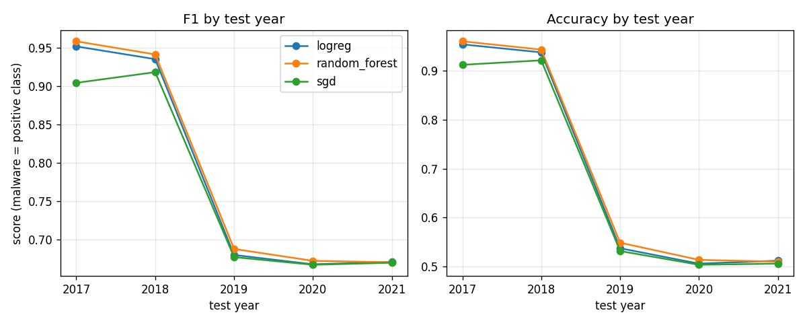

# Step 6 Report: Test Results

Written by the builder agent. All numbers below were produced by `python -m src.main --step 6` (about 47 s when run alone, which also trains the three models on 2014-2016; in the full pipeline Step 6 reuses the Step 4 models). They are saved in `results/`.

## What was done

- Each trained classifier (logreg, random forest, SGD; fit on 2014-2016 only in Step 4) predicts each test year 2017-2021 separately. The models and the preprocessor are not refit or tuned on any test year; test rows only go through `transform` and `predict`. `assert_test_years_only` raises if any other year is passed.
- Code: `per_year_table` (already in `src/evaluate.py`) plus new `drift_summary`, `year_baseline_table`, `by_year_export` and `plot_by_year`; entry point `main.run_step6` (`--step 6`). `PLAN.md` was updated in its own commit for the new file names.
- Malware (label 1) is the positive class. Every test year is exactly 50% malware and 50% goodware (table below), so the majority-class baseline accuracy is 0.5000 in every year.
- Files: `results/step6_by_year.csv|md` (columns `classifier, year, n, accuracy, precision, recall, f1`), `results/step6_baseline_by_year.csv|md`, `results/step6_drift_summary.csv|md`, `results/step6_per_year_no_dup.csv|md`, `results/step6_confusion_by_year.csv|md`, `results/step6_clip_by_year.csv|md`, `results/step6_by_year.png` (the accuracy panel has a dashed line at the 0.5 chance level).

## Results by test year

| Test year | n | Malware / goodware | Baseline accuracy (majority class) |
|---|---|---|---|
| 2017 | 18000 | 9000 / 9000 | 0.5000 |
| 2018 | 18000 | 9000 / 9000 | 0.5000 |
| 2019 | 3000 | 1500 / 1500 | 0.5000 |
| 2020 | 3000 | 1500 / 1500 | 0.5000 |
| 2021 | 3000 | 1500 / 1500 | 0.5000 |

| Classifier | Year | n | Accuracy | Precision | Recall | F1 |
|---|---|---|---|---|---|---|
| logreg | 2017 | 18000 | 0.9534 | 0.9938 | 0.9124 | 0.9514 |
| logreg | 2018 | 18000 | 0.9371 | 0.9706 | 0.9016 | 0.9348 |
| logreg | 2019 | 3000 | 0.5377 | 0.5200 | 0.9807 | 0.6796 |
| logreg | 2020 | 3000 | 0.5063 | 0.5032 | 0.9907 | 0.6674 |
| logreg | 2021 | 3000 | 0.5123 | 0.5063 | 0.9920 | 0.6704 |
| random_forest | 2017 | 18000 | 0.9596 | 0.9971 | 0.9219 | 0.9580 |
| random_forest | 2018 | 18000 | 0.9427 | 0.9716 | 0.9121 | 0.9409 |
| random_forest | 2019 | 3000 | 0.5490 | 0.5260 | 0.9920 | 0.6875 |
| random_forest | 2020 | 3000 | 0.5140 | 0.5071 | 0.9953 | 0.6719 |
| random_forest | 2021 | 3000 | 0.5103 | 0.5052 | 0.9947 | 0.6701 |
| sgd | 2017 | 18000 | 0.9117 | 0.9907 | 0.8311 | 0.9039 |
| sgd | 2018 | 18000 | 0.9209 | 0.9547 | 0.8837 | 0.9178 |
| sgd | 2019 | 3000 | 0.5320 | 0.5169 | 0.9800 | 0.6768 |
| sgd | 2020 | 3000 | 0.5040 | 0.5020 | 0.9927 | 0.6668 |
| sgd | 2021 | 3000 | 0.5063 | 0.5032 | 1.0000 | 0.6695 |

Check against Step 5: weighting the per-year accuracies by n gives the pooled accuracies of Step 5 (logreg 0.8600, random forest 0.8658, SGD 0.8358).

## Effect of drift

**Shape of the decline.** Performance does not fall gradually with distance from the 2014-2016 training period. For 2017 and 2018 all three classifiers are strong (accuracy 0.91-0.96, F1 0.90-0.96, 41-46 points above the 0.5 baseline). From 2017 to 2018 the change is small: F1 drops 0.0166 (logreg) and 0.0171 (random forest) and rises 0.0139 for SGD. Then from 2018 to 2019 there is a cliff: F1 drops by 0.2552 (logreg), 0.2534 (random forest) and 0.2410 (SGD). Accuracy in 2019-2021 is 0.504-0.549, i.e. 0.4 to 4.9 points above the majority-class baseline of 0.5000. After 2019 there is no consistent further decline: F1 for 2019, 2020 and 2021 is within 0.018 for each classifier (logreg 0.012, random forest 0.017, SGD 0.010).

**What the models do in 2019-2021.** Recall stays very high (0.980-1.000) while precision falls to 0.502-0.526. This is the pattern of a classifier that labels almost everything as malware. For example, for logreg in 2021, precision 0.5063 with recall 0.9920 (1,488 of 1,500 malware caught) implies about 1,451 of the 1,500 goodware apps flagged (derived from the two numbers, about 97%). An F1 of about 0.667 is exactly the F1 of a model that always predicts malware on a balanced set (2*0.5/(0.5+1)); the 2019-2021 F1 values (0.6668-0.6875) are only 0.0001-0.0208 above that. So the F1 of 0.67 should not be read as "moderate" performance: accuracy shows these years are close to chance. The classes are balanced in every year, so the low precision comes from many false positives, not from the class mix.

**Confusion counts and predicted-malware share by year** (`results/step6_confusion_by_year.csv|md`; every year has 50% malware, so a share of 0.50 would be neutral):

| Classifier | Year | TN | FP | FN | TP | Predicted malware share |
|---|---|---|---|---|---|---|
| logreg | 2017 | 8949 | 51 | 788 | 8212 | 0.4591 |
| logreg | 2018 | 8754 | 246 | 886 | 8114 | 0.4644 |
| logreg | 2019 | 142 | 1358 | 29 | 1471 | 0.9430 |
| logreg | 2020 | 33 | 1467 | 14 | 1486 | 0.9843 |
| logreg | 2021 | 49 | 1451 | 12 | 1488 | 0.9797 |
| random_forest | 2017 | 8976 | 24 | 703 | 8297 | 0.4623 |
| random_forest | 2018 | 8760 | 240 | 791 | 8209 | 0.4694 |
| random_forest | 2019 | 159 | 1341 | 12 | 1488 | 0.9430 |
| random_forest | 2020 | 49 | 1451 | 7 | 1493 | 0.9813 |
| random_forest | 2021 | 39 | 1461 | 8 | 1492 | 0.9843 |
| sgd | 2017 | 8930 | 70 | 1520 | 7480 | 0.4194 |
| sgd | 2018 | 8623 | 377 | 1047 | 7953 | 0.4628 |
| sgd | 2019 | 126 | 1374 | 30 | 1470 | 0.9480 |
| sgd | 2020 | 23 | 1477 | 11 | 1489 | 0.9887 |
| sgd | 2021 | 19 | 1481 | 0 | 1500 | 0.9937 |

This replaces the earlier estimate derived from precision and recall with exact counts: in 2019-2021 the classifiers call 94.3-99.4% of all apps malware and correctly identify only 1.3-10.6% of goodware (specificity, TN / 1500: random forest 2019 159/1500 = 10.6%, SGD 2021 19/1500 = 1.3%). In 2017-2018 the models do the opposite and slightly under-predict malware (share 0.42-0.47, 703 to 1,520 missed malware per year, but almost all goodware recognised). The failure at 2019 is therefore a sharp shift of the predicted class, not a graded loss of accuracy. F1 of about 0.67 is the always-malware F1 on a balanced set and should not be read as moderate performance.

**Preprocessing extremes versus real drift.** To check whether the 2019-2021 collapse is an artefact of the preprocessing (log1p, standard scaling fitted on 2014-2016, clip at +-Z_CLIP), the code now measures, per year and before clipping, the share of scaled entries beyond the clip and the mean absolute z-score (`results/step6_clip_by_year.csv|md`; the training years are included for reference):

| Side | Year | n | Clip share | Mean abs z |
|---|---|---|---|---|
| train | 2014 | 18000 | 0.0008 | 0.3390 |
| train | 2015 | 18000 | 0.0010 | 0.3487 |
| train | 2016 | 18000 | 0.0015 | 0.4042 |
| test | 2017 | 18000 | 0.0018 | 0.3848 |
| test | 2018 | 18000 | 0.0030 | 0.4382 |
| test | 2019 | 3000 | 0.0051 | 0.5190 |
| test | 2020 | 3000 | 0.0071 | 0.6119 |
| test | 2021 | 3000 | 0.0106 | 0.8050 |

What this shows: (1) The clipped share is small in every year (at most 1.06% of entries, in 2021), so clipping touches few values and cannot by itself turn a 0.46 predicted-malware share into 0.94. (2) The extremes grow steadily from year to year, with no jump at 2019: clip share 0.0018, 0.0030, 0.0051, 0.0071, 0.0106 and mean absolute z 0.385, 0.438, 0.519, 0.612, 0.805. The 2018 to 2019 change in these numbers (0.0021 clip share, 0.081 mean abs z) is smaller than the 2021 against 2020 change (0.0035, 0.193), yet performance collapses between 2018 and 2019 and does not change between 2020 and 2021. So the size of the extremes does not follow the shape of the cliff. (3) The mean absolute z-score rises by more than a factor of two from 2014 (0.339) to 2021 (0.805): later data sit further from the 2014-2016 feature means and variances, which is feature drift measured in the training scale, consistent with the rising Step 2 KS values. The earlier years do not show the same effect. Conclusion: the evidence points to real distribution drift (the 2019-2021 files differ from 2014-2018 on many features), not to a preprocessing artefact from a few extreme values. I did not test it directly (for example by changing the clip value or the scaler), so I cannot say whether a different preprocessing would reduce the shift in predicted class; and these numbers cannot separate real change in app behaviour from a change in how the 2019-2021 files were collected (they are also much smaller, 1,500 rows per file against 9,000).

**Per-year drift summary** (`results/step6_drift_summary.csv`, first test year 2017 vs last 2021):

| Classifier | F1 2017 | F1 2021 | F1 drop | F1 slope per year |
|---|---|---|---|---|
| logreg | 0.9514 | 0.6704 | 0.2810 | -0.0829 |
| random_forest | 0.9580 | 0.6701 | 0.2879 | -0.0845 |
| sgd | 0.9039 | 0.6695 | 0.2344 | -0.0720 |

The slope is a straight-line fit over five points whose pattern is a step, so it is descriptive only: it suggests a gradual decline of about 0.07-0.08 F1 per year that the data do not show, and the fit is unweighted although 2017 and 2018 have six times as many rows as the other years. The change that matters is the 2018 to 2019 step: F1 falls from 0.9348 to 0.6796 (-0.2552) for logreg, from 0.9409 to 0.6875 (-0.2534) for random forest and from 0.9178 to 0.6768 (-0.2410) for SGD, against changes of -0.017 to +0.014 from 2017 to 2018 and within 0.018 from 2019 to 2021. SGD has the smallest drop only because it starts lowest in 2017.

**Classifier comparison.** The random forest has the highest F1 in 2017, 2018 and 2019 and logreg is close behind (0.006-0.007 lower in 2017-2018). SGD is lowest in 2017 and 2018 (F1 0.9039 and 0.9178; 0.048-0.054 below the others in 2017, 0.017-0.023 in 2018). In 2020 and 2021 the three classifiers are within 0.005 (2020) and 0.001 (2021) F1 of each other. None of the three is robust to the change at 2019, and no classifier ranking in 2019-2021 is reliable (see noise below).

## Comparison with the Step 2 drift numbers

Step 2 mean KS statistic vs 2014 (`results/step2_ks_vs_2014.csv`, each year balanced to 3,000 rows):

| Year | 2015 | 2016 | 2017 | 2018 | 2019 | 2020 | 2021 |
|---|---|---|---|---|---|---|---|
| mean KS vs 2014 | 0.0226 | 0.0363 | 0.0437 | 0.0432 | 0.0515 | 0.0612 | 0.0849 |
| share significant | 0.164 | 0.218 | 0.259 | 0.251 | 0.273 | 0.347 | 0.369 |

**Do the years with the most drift have the lowest F1? Partly.** The three years with the largest KS vs 2014 (2021, 2020, 2019) are the three years with the lowest F1 and accuracy for every classifier, and the two lowest-KS test years (2018 and 2017, 0.0432 and 0.0437) have the highest F1. The direction agrees. But the size does not match: mean KS rises only from 0.0437 (2017) to 0.0515 (2019), while F1 falls by about 0.27. Within 2019-2021, KS keeps rising (0.0515, 0.0612, 0.0849) while F1 and accuracy stay flat near chance, and F1 is not ordered by KS (for logreg, 2020 is slightly lower than 2021; for random forest, 2021 is slightly lower than 2020). 2017 has a slightly higher KS than 2018 (0.0437 vs 0.0432, a gap of 0.0005) but a higher F1 for logreg and random forest; I do not read anything into so small a KS gap. The consecutive-year KS (`results/step2_ks_consecutive.csv`) has no spike at the 2018 to 2019 step: 2018-2019 is 0.0277, close to 2016-2017 (0.0276) and 2019-2020 (0.0231), and the largest consecutive value is 2020-2021 (0.0487), where F1 does not change. So the mean KS statistic does not locate the cliff.

**Which Step 2 numbers are compared.** Two Step 2 outputs are used: the mean KS statistic vs 2014 and consecutive-year KS (`step2_ks_vs_2014.csv`, `step2_ks_consecutive.csv`) and the accuracy matrix (`step2_accuracy_matrix.csv`). The closest like-for-like Step 2 numbers are the 2014-trained row of the matrix, accuracy on 2017 to 2021: 0.8177, 0.8873, 0.6377, 0.6303, 0.5190, against the Step 6 logreg accuracies of 0.9534, 0.9371, 0.5377, 0.5063, 0.5123 (the 2016-trained row is quoted below). The two are not the same experiment: Step 2 used balanced samples of 3,000 rows per year, one logistic regression fit on a single year (2014) and no shared preprocessing choices with Step 4, whereas Step 6 uses all rows (18,000 for 2017-2018), three classifiers fit on 2014-2016 together with the Step 3 preprocessing. So the values differ (for example 2017: 0.8177 against 0.9534) and only the shape is compared: a high-then-low pattern with the break at 2018 to 2019. No join table was written.

The Step 2 accuracy matrix (`results/step2_accuracy_matrix.csv`, 3,000 balanced rows per year, a logistic regression fit on a single year) does show the same cliff. The model trained on 2016 scores 0.9667 on 2017 and 0.9353 on 2018, then 0.5743, 0.5410 and 0.3507 on 2019, 2020 and 2021. Models trained on 2014, 2015, 2017 and 2018 also score only 0.52-0.67 on 2019-2021, so the cliff is not caused by the 2014-2016 training period being old: models trained on 2017 or 2018 fail on 2019-2021 as well. By contrast the models trained on 2019, 2020 and 2021 do well on each other (0.73-0.94) and worse on earlier years (0.57-0.85). This suggests that the 2019-2021 data differ from 2014-2018 in a way that a model fit on 2014-2018 does not transfer (the relationship between features and label, not only the feature distribution, which is concept drift in the Step 2 sense). I did not test why. Possible reasons that I have not checked: a real change in malware and goodware behaviour, or a different collection or labelling process for the smaller 2019-2021 files (they also have 3,000 rows against 18,000, and far fewer repeated apknames, Step 1).

## Sensitivity: test rows with no exact duplicate in 2014-2016

Files: `results/step6_per_year_no_dup.csv|md`. Rows whose exact feature vector also occurs in 2014-2016 are removed (5,972 of 18,000 in 2017, 1,645 in 2018, 57 in 2019, 67 in 2020, 2 in 2021). Unlike the full table, this subset is not exactly balanced, so the baseline above does not apply to it; the table now has `n_malware`, `n_benign` and `baseline_accuracy` per year. Baseline accuracy of the kept rows: 2017 0.6630 (4,053 malware / 7,975 goodware), 2018 0.5203, 2019 0.5025, 2020 0.5094, 2021 0.5003. Accuracy / F1:

| Classifier | 2017 | 2018 | 2019 | 2020 | 2021 |
|---|---|---|---|---|---|
| logreg | 0.9609 / 0.9392 | 0.9467 / 0.9430 | 0.5304 / 0.6751 | 0.4971 / 0.6596 | 0.5120 / 0.6701 |
| random_forest | 0.9683 / 0.9510 | 0.9526 / 0.9496 | 0.5420 / 0.6831 | 0.5049 / 0.6642 | 0.5100 / 0.6698 |
| sgd | 0.9644 / 0.9452 | 0.9448 / 0.9419 | 0.5267 / 0.6742 | 0.4957 / 0.6599 | 0.5060 / 0.6692 |

The 2017 filter changes F1 by -0.012 (logreg), -0.007 (random forest) and +0.041 (SGD) and raises accuracy for all three, but the 2017 subset is 66% goodware (baseline 0.6630), so the gain over the baseline is 0.30 rather than 0.46 and accuracy there is not comparable to the full-year number. The duplicates therefore do not explain the good 2017 result (F1 stays 0.94-0.95). 2019-2021 barely change because almost no rows are removed, and the cliff at 2019 is present in this subset as well (accuracy 0.4957-0.5420 against baselines of 0.5003-0.5094).

## Caveats

- **Noisier late years.** 2019-2021 have 3,000 rows each (1,500 per class) against 18,000 for 2017 and 2018. A rough binomial standard error for accuracy near 0.5 with n = 3,000 is about 0.009 (about 0.0016 for accuracy near 0.95 with n = 18,000), ignoring that duplicate rows (Step 1) make the effective sample smaller. So differences of a few points between 2019, 2020 and 2021 (for example logreg 0.5377 vs 0.5063) are only a few standard errors and I do not rank those years. The three classifiers are evaluated on the same rows, so their differences within a year are paired, but the same limit applies. The step between 2018 and 2019 (about 0.4 in accuracy) is far outside this noise.
- **Class balance and precision.** Every test year is exactly 50/50, so precision is comparable across years and the baseline accuracy is the same (0.5000). If the real-world malware share were lower, the same false-positive rate would give lower precision; that is not tested here. The no-duplicate subset is the only one with a changed mix (see above).
- **Single fit, no tuning.** The classifiers use the Step 4 default settings and a single `random_state=42` fit, so differences of about one point between classifiers (for example 2017-2018 logreg vs random forest) are small and the run-to-run spread was not measured.
- **Pooled numbers.** The pooled Step 5 table is 80% 2017-2018, so it hides the 2019-2021 collapse. The per-year table here is the primary view.
- **Duplicates and conflicting labels** (Step 1) are kept, as planned. The KS numbers quoted from Step 2 are effect sizes from a balanced 3,000-row sample per year and were not used to choose anything in Step 6.
