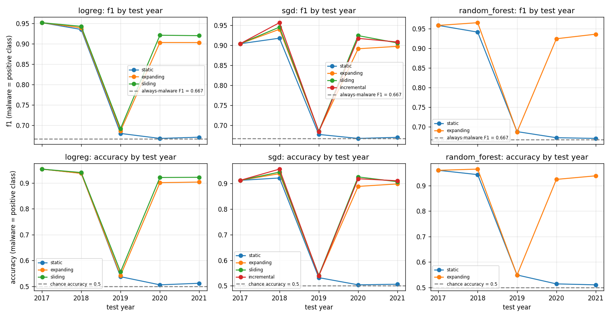

# Step 7 Report: Sustainable Approach

Written by the builder agent. All numbers come from `python -m src.main` (whole pipeline, 6 min 54 s on this machine, 12 cores; `--step 7` alone is similar because it also trains the Step 4 models). Files are in `results/step7_*`.

## Approach

Four strategies were compared on the same test rows (2017-2021, 45,000 rows) with the same metrics as Steps 5 and 6 (malware = positive class). Code: `src/sustainable.py`, entry point `main.run_step7`.

| Strategy | Training data used to predict year t | Classifiers run |
|---|---|---|
| (a) static | 2014-2016 only, never updated (the Step 4 models are reused, nothing is refit) | logreg, SGD, random forest |
| (b) expanding window | all years before t (2014..t-1); preprocessing and model refit from scratch for each t | logreg, SGD, random forest |
| (c) sliding window | the 3 years before t; preprocessing and model refit for each t | logreg, SGD |
| (d) incremental | SGD fit on 2014-2016, then for each t: predict t, then `partial_fit` on t (test-then-train) | SGD |

- **Same preprocessing rules everywhere.** For (b) and (c) a new `Preprocessor` (log1p, minimum-support filter of 10 non-zero rows, `StandardScaler`, clip at +-10) is fit on that window's rows only. For (d) the preprocessor is fit on 2014-2016 and then frozen, so the scaler and the column mask never see a later year. A column that only becomes active after 2016 therefore stays dropped in (a) and (d) but can enter in (b) and (c).
- **No year is ever used before it is predicted.** Every window fit goes through `fit_on_years`, which calls `check_no_overlap(window, [t])` and raises if any window year is >= t; `window_years` raises on the same condition. `run_incremental` checks before every prediction that all years seen so far are < t. For t = 2017 the windows of (a), (b) and (c) are all 2014-2016, so those rows are identical (same model, same data).
- **Labels are assumed to be available right after year t ends** (test-then-train). A real labelling delay would hurt (b), (c) and (d); it is not simulated.
- **Not run:** sliding window and incremental for random forest (random forest has no `partial_fit`; the sliding window was left out to save time, as specified for this step). SGD has all four strategies so the incremental gain is compared with the same model family.

## Comparison with a never-updated model

Per-year F1 (accuracy in brackets), from `results/step7_strategies.csv|md`. Every test year is 50% malware, so accuracy 0.5 and F1 0.667 (always predict malware) are the trivial levels.

| Classifier / strategy | 2017 | 2018 | 2019 | 2020 | 2021 |
|---|---|---|---|---|---|
| logreg static | 0.9514 (0.9534) | 0.9348 (0.9371) | 0.6796 (0.5377) | 0.6674 (0.5063) | 0.6704 (0.5123) |
| logreg expanding | 0.9514 (0.9534) | 0.9389 (0.9368) | 0.6861 (0.5430) | 0.9027 (0.9010) | 0.9026 (0.9033) |
| logreg sliding | 0.9514 (0.9534) | 0.9424 (0.9401) | 0.6917 (0.5567) | 0.9206 (0.9210) | 0.9196 (0.9217) |
| sgd static | 0.9039 (0.9117) | 0.9178 (0.9209) | 0.6768 (0.5320) | 0.6668 (0.5040) | 0.6695 (0.5063) |
| sgd expanding | 0.9039 (0.9117) | 0.9401 (0.9377) | 0.6845 (0.5397) | 0.8913 (0.8880) | 0.8974 (0.8977) |
| sgd sliding | 0.9039 (0.9117) | 0.9456 (0.9439) | 0.6848 (0.5410) | 0.9243 (0.9250) | 0.9059 (0.9063) |
| sgd incremental | 0.9039 (0.9117) | 0.9566 (0.9556) | 0.6837 (0.5387) | 0.9174 (0.9180) | 0.9082 (0.9100) |
| random forest static | 0.9580 (0.9596) | 0.9409 (0.9427) | 0.6875 (0.5490) | 0.6719 (0.5140) | 0.6701 (0.5103) |
| random forest expanding | 0.9580 (0.9596) | 0.9649 (0.9644) | 0.6866 (0.5487) | 0.9241 (0.9240) | 0.9357 (0.9380) |

The static rows equal the Step 6 numbers (they are computed from the same Step 4 models).

Summary against the never-updated model of the same classifier (`results/step7_summary.csv|md`). Mean F1 is the unweighted mean of the five yearly F1 values; "worst year" is the lowest yearly F1.

| Classifier | Strategy | Mean F1 (2017-21) | Gain vs static | Worst year (F1) | Mean F1 2019-21 | Mean accuracy 2019-21 | Pooled F1 |
|---|---|---|---|---|---|---|---|
| logreg | static | 0.7807 | 0 | 2020 (0.6674) | 0.6725 | 0.5188 | 0.8683 |
| logreg | expanding | 0.8763 | +0.0956 | 2019 (0.6861) | 0.8305 | 0.7824 | 0.9150 |
| logreg | sliding | 0.8851 | +0.1044 | 2019 (0.6917) | 0.8440 | 0.7998 | 0.9195 |
| sgd | static | 0.7670 | 0 | 2020 (0.6668) | 0.6710 | 0.5141 | 0.8434 |
| sgd | expanding | 0.8635 | +0.0965 | 2019 (0.6845) | 0.8244 | 0.7751 | 0.8965 |
| sgd | sliding | 0.8729 | +0.1059 | 2019 (0.6848) | 0.8383 | 0.7908 | 0.9013 |
| sgd | incremental | 0.8740 | +0.1070 | 2019 (0.6837) | 0.8364 | 0.7889 | 0.9053 |
| random forest | static | 0.7857 | 0 | 2021 (0.6701) | 0.6765 | 0.5244 | 0.8742 |
| random forest | expanding | 0.8939 | +0.1082 | 2019 (0.6866) | 0.8488 | 0.8036 | 0.9316 |

Pooled values (`results/step7_pooled.csv|md`) weight 2017-2018 six times as much as 2019-2021, so the per-year table is the main view. `results/step7_vs_static.csv|md` gives the per-year differences.

### Does retraining on 2017 and 2018 fix the 2019 collapse?

**No.** Every strategy still collapses in 2019. With data up to 2018 in the training window, 2019 accuracy is 0.5387-0.5567 (static 0.5320-0.5490) and F1 0.684-0.692 against 0.667 for always predicting malware. The gain over the static model in 2019 is at most +0.0121 F1 (logreg sliding) and +0.0190 accuracy (logreg sliding, 0.5567 vs 0.5377). The collapse pattern is unchanged: logreg expanding on 2019 flags 1,369 of 1,500 goodware apps as malware (static: 1,358) and misses 2 of 1,500 malware (static: 29); recall is 0.989-0.999 and precision 0.52-0.53 for all strategies.

**Retraining fixes 2020 and 2021, but only after 2019 data is in the window.** Once 2019 rows (labelled after 2019 ended) are in the training window, accuracy for 2020 and 2021 jumps from about 0.50-0.51 (static) to 0.89-0.94: for example logreg sliding 0.9210 / 0.9217, SGD incremental 0.9180 / 0.9100, random forest expanding 0.9240 / 0.9380. Gains over static in 2020 are +0.2353 F1 (logreg expanding, 0.9027 vs 0.6674) and +0.2506 (SGD incremental, 0.9174 vs 0.6668), similar in 2021. So the data of the shifted year itself is what repairs the model; the two years before it (2017 and 2018) are not enough. This is a one-year lag: the first year after the shift is lost under any strategy that needs labels after the year ends.

**Small contributions from the 2019 rows.** 2019 is only 3,000 of 93,000 rows (3.2%) in the 2020 expanding window, yet it repairs the model. Retraining on small amounts of recent data helps a lot; the same row-count imbalance (below) means the expanding window is still dominated by 2014-2018 and does less well than the sliding window and incremental model in 2020-2021 (logreg: F1 0.9027 vs 0.9206 in 2020; SGD: 0.8913 vs 0.9243). That difference is consistent with recency helping but is not isolated from the different window sizes, so I do not claim it as proven.

**2018.** Retraining already helps a little before the cliff: SGD incremental gains +0.0388 F1 over static in 2018 (0.9566 vs 0.9178) and random forest expanding +0.0240 (0.9649 vs 0.9409); logreg gains only +0.0041 to +0.0076. These are small compared with the 2020-2021 effect.

**Reading the comparison.** Every number here comes from one run with seed 42, and there is no uncertainty estimate, so small differences are not evidence of a real ordering. The differences between expanding, sliding and incremental updates are too small to rank. The robust conclusion is only that any form of updating beats the static model from 2020 onward. Strategies are compared within one classifier (SGD is the only classifier that has all four strategies). Ordering between classifiers is not the main finding, and random forest was not run with sliding or incremental windows.

## Window composition

Years 2014-2018 have 18,000 rows each and 2019-2021 have 3,000 (`results/step7_window_composition.csv|md`), so old years dominate any window that includes them. Rows per year in the training window behind each prediction:

| Strategy | Test year | Window | Train rows | Rows from 2014-2018 | Share of the newest window year |
|---|---|---|---|---|---|
| static | 2017-2021 (all) | 2014-2016 | 54,000 | 54,000 (100%) | 33.3% (2016) |
| expanding / incremental | 2017 | 2014-2016 | 54,000 | 100% | 33.3% |
| expanding / incremental | 2018 | 2014-2017 | 72,000 | 100% | 25.0% |
| expanding / incremental | 2019 | 2014-2018 | 90,000 | 100% | 20.0% |
| expanding / incremental | 2020 | 2014-2019 | 93,000 | 96.8% | 3.2% (2019) |
| expanding / incremental | 2021 | 2014-2020 | 96,000 | 93.8% | 3.1% (2020) |
| sliding | 2017 | 2014-2016 | 54,000 | 100% | 33.3% |
| sliding | 2018 | 2015-2017 | 54,000 | 100% | 33.3% |
| sliding | 2019 | 2016-2018 | 54,000 | 100% | 33.3% |
| sliding | 2020 | 2017-2019 | 39,000 | 92.3% | 7.7% (2019) |
| sliding | 2021 | 2018-2020 | 24,000 | 75.0% | 12.5% (2020) |

Consequences: (1) the expanding window and the incremental model are about 94-97% 2014-2018 data when they predict 2020 and 2021, and the shifted 2019-2020 data is a small minority; (2) the sliding window is the most "recent" for 2021 only because it has dropped older years, and for 2021 18,000 of its 24,000 rows are from 2018; (3) "retraining helps or not" mixes recency with these row counts. No equal-rows variant was run. The incremental model has seen the same years as the expanding window, but through one `partial_fit` pass per year, and its preprocessor only ever saw 2014-2016.

## Cost

Training seconds per update (`results/step7_cost.csv|md`; this machine, 12 cores, times vary by a few seconds between runs; includes preprocessing fit for (b) and (c)):

| Strategy | Classifier | Fits / updates | Total seconds | Mean seconds per update | Mean training rows |
|---|---|---|---|---|---|
| static | logreg | 1 | 2.65 | 2.65 | 54,000 |
| expanding | logreg | 5 | 54.36 | 10.87 | 81,000 |
| sliding | logreg | 5 | 31.32 | 6.26 | 45,000 |
| static | sgd | 1 | 5.02 | 5.02 | 54,000 |
| expanding | sgd | 5 | 61.60 | 12.32 | 81,000 |
| sliding | sgd | 5 | 40.28 | 8.06 | 45,000 |
| incremental | sgd | 5 (1 initial fit + 4 updates counted before predictions) | 7.36 | 1.47 (initial fit 7.13 s, each update about 0.06 s) | 19,200 |
| static | random forest | 1 | 8.18 | 8.18 | 54,000 |
| expanding | random forest | 5 | 100.56 | 20.11 | 81,000 |

For the incremental model the seconds in a row are those of the update that produced the model used for that row (the 2017 row holds the initial fit); the update after 2021 is not counted since no later year is predicted. An incremental update is two orders of magnitude cheaper than a refit (about 0.06 s per year against 6-20 s), and in these results it is as accurate as the sliding window (pooled F1 0.9053 vs 0.9013 for SGD). Whole pipeline: 6 min 54 s, within the 15-minute budget.

## Limits

- Only one shift was observed (2019). Conclusions about "how often" to retrain rest on one event and five test years.
- 2020 and 2021 are only 3,000 rows each; yearly differences of 1-2 F1 points are small relative to that sample size and no confidence intervals were computed.
- Test-then-train assumes labels arrive immediately after the year. In practice analysts label with a delay, and the 2019 collapse would last as long as it takes to label enough 2019 apps.
- Exact duplicates (many in 2014-2018) are kept, as everywhere else; duplicates between training windows and test years grow as windows include 2017-2018 (Step 1 reports 33% of 2017 rows are also in 2014-2016), which may flatter the retraining strategies in 2018 (not measured here).

## Conclusions for REPORT.md

- **Retrain once a year at least; it recovers ~0.9 accuracy but only after the shifted year is labelled.** Models updated with 2019 data score 0.89-0.94 accuracy on 2020-2021 against 0.50-0.51 for the never-updated model (mean F1 over 2017-2021: 0.86-0.89 against 0.77-0.79). Retraining on data up to 2018 did nothing for 2019 (accuracy 0.54-0.56): no yearly schedule avoids the first collapsed year.
- **Prefer cheaper updates, but do not expect them to fix sudden drift.** Updating beats the static model from 2020 onward, and sliding-window and incremental updates reached similar 2020-2021 results to the expanding window (logreg sliding mean F1 0.8851, SGD incremental 0.8740) at lower cost (sliding about 6 s per refit with logreg; incremental about 0.06 s per year after a 7 s initial fit; expanding 11-20 s per refit on 81,000 rows on average). The differences between these strategies are small and come from one seed with no uncertainty estimate, so they should not be ranked. No strategy recovered 2019, so none of them is sustainable across all years. Caveat: window sizes and year mix differ, so recency is not isolated.
- **Trigger retraining from the label-free output and a labelled check, not from Step 2 KS feature drift.** The KS statistic between consecutive years did not flag 2019 (0.0277 for 2018 to 2019, against 0.023-0.028 for every other pair up to 2020); its largest step was 2020 to 2021 (0.0487), when a retrain on 2019-2020 data was already working. The concept-drift signal did flag it: in Step 2 the 2018 model scores 0.97 on 2018 and 0.60 on 2019. Step 6 shows a cheap warning that needs no labels: the share of apps predicted malware jumped from 0.46-0.47 to 0.94-0.98 in 2019-2021 on a test set known to be 50% malware (in real data the true share is unknown, so this needs a reference). Recommended trigger: accuracy or recall/precision on a small, freshly labelled sample of the newest year, with the predicted-malware share as an early warning.
- **After a trigger, retrain on the new year's labelled data immediately.** Because the 2019 repair needed only 3,000 labelled rows (3% of the window), a small labelled sample of the new year is enough to restart, and the labelling delay is then the main sustainability cost, not compute.
- **What was not shown:** a gradual drift schedule (only one abrupt shift occurs in 2017-2021), random forest with sliding or incremental updates, and equal-row windows.
