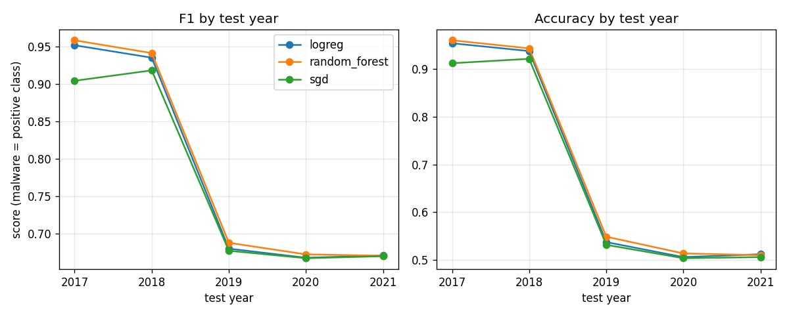

# Transcript: builder, Step 6 (started 2026-11-03T05:45:42+02:00)

## User 2026-11-03T03:46:32.596Z

<pasted_content id="da07">
You are the BUILDER agent for Project 2 (Android malware classification under data drift).

You write and edit the project code. Two other agents work separately: a reviewer reviews your changes and a tester writes tests from the assignment. They cannot see this conversation.

Read these files first: AGENTS.md, ASSIGNMENT.md, PLAN.md.

## Your task: Step 6, Test Data Prediction

1. Implement Step 6 as described in ASSIGNMENT.md and PLAN.md. Do only this step.
2. Put code in src/. Run it on the real data in input_data/ and check the output.
3. Fill in docs/step6_test_results.md with what you did and the actual results (numbers, tables). Replace every [TODO] marker.
4. Work in small tasks. Commit after each one with a message starting with [builder], e.g., "[builder] Step 6: load files and extract labels".

Fix mode: if reviews/step6_review.md has comments marked Accepted in its Decision log, or tests/step6_test_log.md shows failing tests marked Accepted, fix those first. Mention the comment number or test name in each fix commit.

## Rules

- Do not create or edit anything in tests/, reviews/, or transcripts/. Those belong to the tester, the reviewer, and the student.
- If PLAN.md must change, say why and update it in its own commit.
- Do not claim results you have not produced by running the code.
- End by listing what you changed, the commits you made, and anything left unfinished.

This session's transcript will be saved as transcripts/30_2026-11-03_builder_step6.md.
</pasted_content id="da07">

<pasted_content id="da07">
Fix mode for Step 6. Read the Decision log at the end of reviews/step6_review.md and the "Failures and decisions" table in tests/step6_test_log.md.
- Fix every item marked Accepted, most severe first. Ignore items marked Rejected. Use the exact choices written in the Reason column.
- Comment 1 is the most important: add the per-year confusion counts and predicted-malware share, and report the clip share and mean absolute z-score per year. In docs/step6_test_results.md, say clearly what the 2019 to 2021 results show and whether the evidence points to preprocessing extremes or to real drift.
- Comments 5 and 6 are report-only: put them in docs/step6_test_results.md in their own commit.
- The one failing test in the log is marked Rejected (the test was wrong, the tester already fixed it), so do not change src/ for it. Do not edit anything in tests/.
- One commit per fix, with the comment number in the message, e.g. "[builder] Step 6: per-year confusion counts and predicted-malware share (review #1)".
- Afterwards rerun the step (python -m src.main --step 6), regenerate results/step6_*, and run `python harness.py test all`. If an existing test fails because of an intended behavior change (for example a new column), do not edit the test: name the test and the reason in your final message and leave it failing.
- Update the numbers and text in docs/step6_test_results.md to match the regenerated results.
- Finish with a table: comment -> what changed -> commit hash.
</pasted_content id="da07">

## User 

<system-reminder>
Codebase and user instructions are shown below. Be sure to adhere to these instructions. IMPORTANT: These instructions OVERRIDE any default behavior and you MUST follow them exactly as written.

Contents of c:\Users\thema\OneDrive\Desktop\Project2\project2-harness2\project2-harness2\CLAUDE.md (project instructions, checked into the codebase):

@AGENTS.md

Contents of c:\Users\thema\OneDrive\Desktop\Project2\project2-harness2\project2-harness2\AGENTS.md (project instructions, checked into the codebase):

# AGENTS.md: Project 2 context for all agents

Every agent (builder, reviewer, tester) reads this file first.

## Project goal

Classify Android apps as malware or goodware from their API-call features, and find a sustainable approach that stays accurate as the data drifts over 8 years (2014-2021). The full assignment is in ASSIGNMENT.md.

## Dataset

- Location: input_data/ (not committed to git).
- 16 CSV files named sampled_<YEAR>_<CLASS>_api.csv, e.g. sampled_2017_malware_api.csv. YEAR is 2014-2021. CLASS is "malware" or "benign" (benign = goodware). One malware file and one benign file per year.
- Year and class come ONLY from the file name. Parse them with a regex; fail loudly on a name that does not match.
- Columns: every file has 1,849 columns. The first column is "apkname" (package name + hash, an identifier). It must be dropped; the other 1,848 columns are API-call features (column names are Dalvik method signatures). All files have the same columns in the same order.
- Rows: ASSIGNMENT.md says 1,500 rows per file, but the real files differ: 2014-2018 files have 9,000 rows each; 2019-2021 files have 1,500 rows each. Code must not assume a fixed row count; it must check 1,849 columns and report the actual row counts.
- Label: target column "label", 1 = malware, 0 = goodware (benign).
- Feature values: non-negative integer call counts, heavy-tailed (max around 92,000). No missing values. Roughly 850-1,125 columns are all-zero within any single file. The 2014-2018 files contain many duplicate rows and repeated apknames; keep them unless PLAN.md justifies otherwise, and report them.
- Memory: the combined data is about 100,000 x 1,848. Load features as int32 or float32, not int64.

## Folder layout

- src/: project code (builder only).
- tests/: pytest tests test_stepN_*.py and test logs stepN_test_log.md (tester only; the student adds failure decisions).
- docs/: one builder report per step.
- reviews/: one review report per step (reviewer writes comments; student writes the decision log).
- results/: CSV and Markdown result tables (and optional PNG figures) written by the code.
- transcripts/: saved agent sessions (saved by the harness; agents never edit these).
- PLAN.md: the plan for Steps 1-7. README.md, REPORT.md and REFLECTION.md: written by the student.

## Coding conventions

- Python 3, pandas, numpy, scikit-learn, scipy. matplotlib is allowed for figures (add it to requirements.txt). No other libraries without asking.
- One module per concern in src/ (e.g. data.py, drift.py, preprocess.py, models.py, evaluate.py, sustainable.py) plus src/main.py as the entry point.
- Every function has a docstring and type hints; comments explain each major step.
- random_state=42 everywhere randomness is used.
- Paths are built with pathlib relative to the repository root. No hard-coded absolute paths.
- Train/test split is by year: training years 2014-2016, test years 2017-2021, with metrics reported for each test year separately. Anything fit to data (scalers, feature selection, models) is fit on training years only. If anything is tuned, tune on a validation year inside the training years, never on test years.
- Malware (label 1) is the positive class for precision, recall, and F1.
- The full pipeline should run in under about 15 minutes on a laptop. Any cache goes in a git-ignored folder.
- Small commits: one task per commit, under about 300 added lines each.

## How to run

- Whole project: python -m src.main (writes results/ and prints a summary).
- One step: python -m src.main --step N
- Tests: python harness.py test N (one step) or python harness.py test all.

## Commit rules

Every commit message starts with a role tag: [builder], [reviewer], [tester], or [student]. A git hook rejects other messages. Make small commits, one per task. Never rewrite or squash history.
</system-reminder>

## User 

<system-reminder>
As you answer the user's questions, you can use the following context:
# userEmail
The user's email address is themalevolence.1@gmail.com. Use it only to identify the user, such as for authorship, attribution, or filtering their own work. Never send it to an unrelated service, such as in a request header, URL, or payload, unless the user explicitly asks.
# gitStatus
This is the git status at the start of the conversation. Note that this status is a snapshot in time, and will not update during the conversation.

Current branch: master

Main branch (you will usually use this for PRs): main

Git user: Daniel

Status:
(clean)

Recent commits:
e8ca5cd [student] step 6 testing fail decision update
8802749 [tester] step 6 testing transcript
dc006ad [tester] Step 6 tests
6195a68 [student] step 6 review and edit decisions
f0a96fc [reviewer] step 6 reviewer transcrit

Claude Code attached this context automatically; it isn't part of the user's message. It describes the user's own account and workspace, so they don't need it reported back.
</system-reminder>

## User 

<system-reminder>
Attribution for git commits and pull requests you create from here on (this replaces Claude Code's own earlier attribution guidance, such as a previous copy of this reminder; the user's own instructions about these lines, such as a CLAUDE.md or memory rule, take precedence over this reminder, but do not add attribution lines this reminder leaves out):
- End git commit messages with:
Co-Authored-By: Claude Sonnet 5.5 <noreply@anthropic.com>
- End pull request descriptions with:
🤖 Generated with [Claude Code](https://claude.com/claude-code)
</system-reminder>

## User 

<pasted_content id="da07">
You are the BUILDER agent for Project 2 (Android malware classification under data drift).

You write and edit the project code. Two other agents work separately: a reviewer reviews your changes and a tester writes tests from the assignment. They cannot see this conversation.

Read these files first: AGENTS.md, ASSIGNMENT.md, PLAN.md.

## Your task: Step 6, Test Data Prediction

1. Implement Step 6 as described in ASSIGNMENT.md and PLAN.md. Do only this step.
2. Put code in src/. Run it on the real data in input_data/ and check the output.
3. Fill in docs/step6_test_results.md with what you did and the actual results (numbers, tables). Replace every [TODO] marker.
4. Work in small tasks. Commit after each one with a message starting with [builder], e.g., "[builder] Step 6: load files and extract labels".

Fix mode: if reviews/step6_review.md has comments marked Accepted in its Decision log, or tests/step6_test_log.md shows failing tests marked Accepted, fix those first. Mention the comment number or test name in each fix commit.

## Rules

- Do not create or edit anything in tests/, reviews/, or transcripts/. Those belong to the tester, the reviewer, and the student.
- If PLAN.md must change, say why and update it in its own commit.
- Do not claim results you have not produced by running the code.
- End by listing what you changed, the commits you made, and anything left unfinished.

This session's transcript will be saved as transcripts/30_2026-11-03_builder_step6.md.
</pasted_content id="da07">

<pasted_content id="da07">
Fix mode for Step 6. Read the Decision log at the end of reviews/step6_review.md and the "Failures and decisions" table in tests/step6_test_log.md.
- Fix every item marked Accepted, most severe first. Ignore items marked Rejected. Use the exact choices written in the Reason column.
- Comment 1 is the most important: add the per-year confusion counts and predicted-malware share, and report the clip share and mean absolute z-score per year. In docs/step6_test_results.md, say clearly what the 2019 to 2021 results show and whether the evidence points to preprocessing extremes or to real drift.
- Comments 5 and 6 are report-only: put them in docs/step6_test_results.md in their own commit.
- The one failing test in the log is marked Rejected (the test was wrong, the tester already fixed it), so do not change src/ for it. Do not edit anything in tests/.
- One commit per fix, with the comment number in the message, e.g. "[builder] Step 6: per-year confusion counts and predicted-malware share (review #1)".
- Afterwards rerun the step (python -m src.main --step 6), regenerate results/step6_*, and run `python harness.py test all`. If an existing test fails because of an intended behavior change (for example a new column), do not edit the test: name the test and the reason in your final message and leave it failing.
- Update the numbers and text in docs/step6_test_results.md to match the regenerated results.
- Finish with a table: comment -> what changed -> commit hash.
</pasted_content id="da07">

**Tool call: Read** 2026-11-03T03:46:34.254Z

```
{
 "file_path": "c:\\Users\\thema\\OneDrive\\Desktop\\Project2\\project2-harness2\\project2-harness2\\reviews\\step6_review.md"
}
```

**Tool result** 2026-11-03T03:46:34.299Z

```
1	# Step 6 Review: Test Data Prediction
2	
3	- Reviewer transcript: transcripts/28_2026-11-03_reviewer_step6.md
4	- What was reviewed: the diff from step6-start to commit 96b40d4 (.harness/diffs/step6_diff.patch), plus src/evaluate.py, src/main.py, src/preprocess.py and src/data.py for context. Read-only checks: I read the result CSVs in the diff by eye (15 rows = 3 classifiers x 5 years; n = 18000+18000+3000+3000+3000 = 45000 per classifier, which matches the pooled Step 5 test set). I did not execute the pipeline.
5	
6	**Verified OK (no comment needed):** results are one row per classifier per test year (15 rows). `run_step6` never fits on a test year: models come from the Step 4 call or from `train_all_from_split(split)` on 2014-2016, and the preprocessor is fit in `prepare_split` on training rows only. `assert_test_years_only` is called before any metric. `compute_metrics` uses `pos_label=1` and `zero_division=0`. The label mapping is untouched. Nothing is trained on a year before it is predicted (Step 6 has no training loop at all). `drift_summary` takes years from the table and does not hard-code or mislabel them.
7	
8	## Comments (reviewer)
9	
10	| # | Severity | Location | Issue | Suggested fix |
11	| --- | --- | --- | --- | --- |
12	| 1 | Medium | src/main.py `run_step6` (and results/step6_by_year.*) | For 2019-2021 all three classifiers have recall about 0.98-1.00, precision about 0.50-0.52 and accuracy about 0.50-0.55 (F1 about 0.67), which is what "predict malware for nearly everything" looks like, not graded degradation. Step 6 only reports these four metrics, so the table cannot show whether this is a sharp predicted-class shift or something else. I am unsure of the cause: it may be real drift, or it may relate to the 2019-2021 files differing from 2014-2018 (1,500 vs 9,000 rows per file); the code does not let a reader tell. F1 is also misleading here, since always-predict-malware scores F1 0.667 on a 50/50 set. | Add per-year confusion counts (tn, fp, fn, tp, e.g. reuse `confusion_counts`) or a predicted-malware share column to a Step 6 table, and state in the report that F1 about 0.67 equals the always-malware baseline. Worth a short check of whether the 2019+ cliff comes from the data or from preprocessing (e.g. how many kept columns are all-zero in 2019-2021). |
13	| 2 | Medium | src/main.py `run_step6`, line with `dup_mask = train_duplicate_mask(df)[...isin(TEST_YEARS)...]` | The no-duplicate mask is aligned with `split["X_test"]` only by assuming `split_by_year` keeps df row order. This is true today, but nothing checks it; if the order ever changed, the sensitivity table would silently drop the wrong rows with no error. Same pattern as `run_step5` (copy-pasted). | Assert before use that `df.loc[df["year"].isin(TEST_YEARS), "year"].to_numpy()` equals `years_test` (and labels equal `y_test`), or compute the mask inside `prepare_split` so alignment is by construction. |
14	| 3 | Low | src/evaluate.py `sensitivity_tables` / resu
... [5315 more characters in the .jsonl file]
```

**Tool call: Read** 2026-11-03T03:46:34.652Z

```
{
 "file_path": "c:\\Users\\thema\\OneDrive\\Desktop\\Project2\\project2-harness2\\project2-harness2\\tests\\step6_test_log.md"
}
```

**Tool result** 2026-11-03T03:46:34.683Z

```
1	# Step 6 Test Log: Test Data Prediction
2	
3	- Tester transcript: transcripts/29_2026-11-03_tester_step6.md
4	
5	## Tests written (tester)
6	
7	One row per test function. Row counts follow AGENTS.md (2014-2018: 9,000 per file, so 18,000 per year; 2019-2021: 1,500 per file, so 3,000 per year), not ASSIGNMENT.md. Entry point tested: main.run_step6 (PLAN.md), plus evaluate.per_year_table.
8	
9	| Test | What it checks (from the assignment or plan) |
10	| --- | --- |
11	| test_one_row_per_test_year_per_classifier | 15 rows: logreg, random_forest, sgd x 2017-2021, no duplicate (model, year) pairs |
12	| test_all_metric_values_between_0_and_1 | accuracy, precision, recall, f1 all in [0,1], no NaN |
13	| test_per_year_n_sums_to_total_test_rows | per-year n adds up to the number of 2017-2021 rows for each classifier; each year's n = rows in that year |
14	| test_no_training_year_in_per_year_table | no 2014-2016 year in any returned table with a year column |
15	| test_step6_writes_expected_files | results/step6_by_year.csv has columns classifier, year, n, accuracy, precision, recall, f1 and 15 rows |
16	| test_step6_only_predicts_with_given_models | stub models raise on fit/partial_fit and Preprocessor.fit is patched to raise; run_step6 still works (predict only) |
17	| test_step6_does_not_refit_passed_models | a fitted LogisticRegression keeps identical coef_/intercept_ after run_step6 |
18	| test_per_year_metrics_hand_checked_two_years | hand-computed two-year example (2017: acc 0.6, P/R/F1 2/3; 2018: acc 0.75, P/R/F1 0 with zero_division) |
19	| test_per_year_metrics_match_sklearn | per-year metrics equal scikit-learn (pos_label=1) on the same rows |
20	| test_run_step6_matches_sklearn_on_same_rows | end to end: run_step6 per-year f1/accuracy equal sklearn on each model's own predictions |
21	| test_year_outside_test_range_is_rejected | years 2013, 2016, 2022 in the test rows raise ValueError |
22	| test_single_class_test_year_does_not_crash | all-malware 2019 and all-benign 2021: 15 rows, no NaN, metrics in [0,1]; 2021 precision/recall/F1 = 0 |
23	| test_missing_test_year_is_not_invented | data without 2019: step raises, or table has exactly 2017, 2018, 2020, 2021 and no fake 2019 row |
24	| test_real_data_each_test_year_has_expected_rows | real data (skipped if absent): 18,000 rows for 2017-2018, 3,000 for 2019-2021; per-year n and metric range with a stub model (no retraining) |
25	
26	## Failures and decisions (student)
27	
28	One row per failing test. Decision is "Accepted" (the test is right; the builder fixes the code) or "Rejected" (the test is wrong; the tester fixes the test). Add the commit with the fix.
29	
30	| Test | Cause | Decision | Fixed in commit |
31	| --- | --- | --- | --- |
32	| test_step6_only_predicts_with_given_models | The test stub asserted that predict always sees all 600 test rows, but run_step6 also predicts on the smaller no-duplicate subset (552 rows), so it failed with 552 == 600. The code is right and the test setup 
... [17583 more characters in the .jsonl file]
```

**Tool call: Glob** 2026-11-03T03:46:35.124Z

```
{
 "pattern": "src/*.py"
}
```

**Tool result** 2026-11-03T03:46:35.315Z

```
src\__init__.py
src\data.py
src\drift.py
src\config.py
src\preprocess.py
src\models.py
src\evaluate.py
src\main.py
```

**Tool call: Read** 

```
{
 "file_path": "c:\\Users\\thema\\OneDrive\\Desktop\\Project2\\project2-harness2\\project2-harness2\\reviews\\step6_review.md"
}
```

**Tool call: Read** 

```
{
 "file_path": "c:\\Users\\thema\\OneDrive\\Desktop\\Project2\\project2-harness2\\project2-harness2\\tests\\step6_test_log.md"
}
```

**Tool call: Glob** 

```
{
 "pattern": "src/*.py"
}
```

**Tool result** 

```
1	# Step 6 Review: Test Data Prediction
2	
3	- Reviewer transcript: transcripts/28_2026-11-03_reviewer_step6.md
4	- What was reviewed: the diff from step6-start to commit 96b40d4 (.harness/diffs/step6_diff.patch), plus src/evaluate.py, src/main.py, src/preprocess.py and src/data.py for context. Read-only checks: I read the result CSVs in the diff by eye (15 rows = 3 classifiers x 5 years; n = 18000+18000+3000+3000+3000 = 45000 per classifier, which matches the pooled Step 5 test set). I did not execute the pipeline.
5	
6	**Verified OK (no comment needed):** results are one row per classifier per test year (15 rows). `run_step6` never fits on a test year: models come from the Step 4 call or from `train_all_from_split(split)` on 2014-2016, and the preprocessor is fit in `prepare_split` on training rows only. `assert_test_years_only` is called before any metric. `compute_metrics` uses `pos_label=1` and `zero_division=0`. The label mapping is untouched. Nothing is trained on a year before it is predicted (Step 6 has no training loop at all). `drift_summary` takes years from the table and does not hard-code or mislabel them.
7	
8	## Comments (reviewer)
9	
10	| # | Severity | Location | Issue | Suggested fix |
11	| --- | --- | --- | --- | --- |
12	| 1 | Medium | src/main.py `run_step6` (and results/step6_by_year.*) | For 2019-2021 all three classifiers have recall about 0.98-1.00, precision about 0.50-0.52 and accuracy about 0.50-0.55 (F1 about 0.67), which is what "predict malware for nearly everything" looks like, not graded degradation. Step 6 only reports these four metrics, so the table cannot show whether this is a sharp predicted-class shift or something else. I am unsure of the cause: it may be real drift, or it may relate to the 2019-2021 files differing from 2014-2018 (1,500 vs 9,000 rows per file); the code does not let a reader tell. F1 is also misleading here, since always-predict-malware scores F1 0.667 on a 50/50 set. | Add per-year confusion counts (tn, fp, fn, tp, e.g. reuse `confusion_counts`) or a predicted-malware share column to a Step 6 table, and state in the report that F1 about 0.67 equals the always-malware baseline. Worth a short check of whether the 2019+ cliff comes from the data or from preprocessing (e.g. how many kept columns are all-zero in 2019-2021). |
13	| 2 | Medium | src/main.py `run_step6`, line with `dup_mask = train_duplicate_mask(df)[...isin(TEST_YEARS)...]` | The no-duplicate mask is aligned with `split["X_test"]` only by assuming `split_by_year` keeps df row order. This is true today, but nothing checks it; if the order ever changed, the sensitivity table would silently drop the wrong rows with no error. Same pattern as `run_step5` (copy-pasted). | Assert before use that `df.loc[df["year"].isin(TEST_YEARS), "year"].to_numpy()` equals `years_test` (and labels equal `y_test`), or compute the mask inside `prepare_split` so alignment is by construction. |
14	| 3 | Low | src/evaluate.py `sensitivity_tables` / resu
... [5315 more characters in the .jsonl file]
```

**Tool result** 

```
1	# Step 6 Test Log: Test Data Prediction
2	
3	- Tester transcript: transcripts/29_2026-11-03_tester_step6.md
4	
5	## Tests written (tester)
6	
7	One row per test function. Row counts follow AGENTS.md (2014-2018: 9,000 per file, so 18,000 per year; 2019-2021: 1,500 per file, so 3,000 per year), not ASSIGNMENT.md. Entry point tested: main.run_step6 (PLAN.md), plus evaluate.per_year_table.
8	
9	| Test | What it checks (from the assignment or plan) |
10	| --- | --- |
11	| test_one_row_per_test_year_per_classifier | 15 rows: logreg, random_forest, sgd x 2017-2021, no duplicate (model, year) pairs |
12	| test_all_metric_values_between_0_and_1 | accuracy, precision, recall, f1 all in [0,1], no NaN |
13	| test_per_year_n_sums_to_total_test_rows | per-year n adds up to the number of 2017-2021 rows for each classifier; each year's n = rows in that year |
14	| test_no_training_year_in_per_year_table | no 2014-2016 year in any returned table with a year column |
15	| test_step6_writes_expected_files | results/step6_by_year.csv has columns classifier, year, n, accuracy, precision, recall, f1 and 15 rows |
16	| test_step6_only_predicts_with_given_models | stub models raise on fit/partial_fit and Preprocessor.fit is patched to raise; run_step6 still works (predict only) |
17	| test_step6_does_not_refit_passed_models | a fitted LogisticRegression keeps identical coef_/intercept_ after run_step6 |
18	| test_per_year_metrics_hand_checked_two_years | hand-computed two-year example (2017: acc 0.6, P/R/F1 2/3; 2018: acc 0.75, P/R/F1 0 with zero_division) |
19	| test_per_year_metrics_match_sklearn | per-year metrics equal scikit-learn (pos_label=1) on the same rows |
20	| test_run_step6_matches_sklearn_on_same_rows | end to end: run_step6 per-year f1/accuracy equal sklearn on each model's own predictions |
21	| test_year_outside_test_range_is_rejected | years 2013, 2016, 2022 in the test rows raise ValueError |
22	| test_single_class_test_year_does_not_crash | all-malware 2019 and all-benign 2021: 15 rows, no NaN, metrics in [0,1]; 2021 precision/recall/F1 = 0 |
23	| test_missing_test_year_is_not_invented | data without 2019: step raises, or table has exactly 2017, 2018, 2020, 2021 and no fake 2019 row |
24	| test_real_data_each_test_year_has_expected_rows | real data (skipped if absent): 18,000 rows for 2017-2018, 3,000 for 2019-2021; per-year n and metric range with a stub model (no retraining) |
25	
26	## Failures and decisions (student)
27	
28	One row per failing test. Decision is "Accepted" (the test is right; the builder fixes the code) or "Rejected" (the test is wrong; the tester fixes the test). Add the commit with the fix.
29	
30	| Test | Cause | Decision | Fixed in commit |
31	| --- | --- | --- | --- |
32	| test_step6_only_predicts_with_given_models | The test stub asserted that predict always sees all 600 test rows, but run_step6 also predicts on the smaller no-duplicate subset (552 rows), so it failed with 552 == 600. The code is right and the test setup 
... [17583 more characters in the .jsonl file]
```

**Tool result** 

```
src\__init__.py
src\data.py
src\drift.py
src\config.py
src\preprocess.py
src\models.py
src\evaluate.py
src\main.py
```

**Tool call: Read** 2026-11-03T03:46:36.780Z

```
{
 "file_path": "c:\\Users\\thema\\OneDrive\\Desktop\\Project2\\project2-harness2\\project2-harness2\\src\\main.py"
}
```

**Tool result** 2026-11-03T03:46:36.818Z

```
1	"""Entry point: python -m src.main [--step N]."""
2	from __future__ import annotations
3	
4	import argparse
5	import sys
6	
7	import pandas as pd
8	
9	from src.config import RESULTS_DIR, TEST_YEARS, TRAIN_YEARS
10	from src.evaluate import (
11	    assert_test_years_only,
12	    baseline_accuracy,
13	    by_year_export,
14	    confusion_table,
15	    drift_summary,
16	    per_year_table,
17	    plot_by_year,
18	    pooled_table,
19	    save_table,
20	    sensitivity_tables,
21	    year_baseline_table,
22	)
23	from src.models import save_models, train_all_from_split, train_with_report
24	from src.preprocess import filter_report, prepare_split, split_table
25	from src.drift import run_drift_analysis
26	from src.data import (
27	    _row_hashes,
28	    train_duplicate_mask,
29	    feature_columns,
30	    file_table,
31	    label_conflict_mask,
32	    load_all,
33	    summarize_data,
34	    write_data_summary,
35	)
36	
37	
38	def run_step1() -> pd.DataFrame:
39	    """Step 1: load and combine the data, write results/step1_*.csv|md, print a summary."""
40	    df = load_all()
41	    summary = summarize_data(df)
42	    write_data_summary(summary, RESULTS_DIR / "step1_data_summary")
43	    write_data_summary(file_table(df), RESULTS_DIR / "step1_file_table")
44	    n_features = len(feature_columns(df))
45	    print(f"Step 1: {len(df)} rows, {n_features} feature columns, memory {df.memory_usage().sum() / 1e6:.0f} MB")
46	    print(summary.to_string(index=False))
47	    # Feature vectors that occur with both labels anywhere in the data (all years pooled).
48	    hashes = _row_hashes(df)
49	    conflict = label_conflict_mask(hashes, df["label"].to_numpy())
50	    print(f"Label conflicts (all years pooled): {len(set(hashes[conflict]))} vectors, {int(conflict.sum())} rows")
51	    return df
52	
53	
54	def run_step2(df: pd.DataFrame | None = None) -> dict[str, pd.DataFrame]:
55	    """Step 2: KS feature drift and the concept-drift accuracy matrix; writes results/step2_*."""
56	    tables = run_drift_analysis(load_all() if df is None else df)
57	    for name in ("ks_vs_2014", "ks_consecutive", "accuracy_matrix"):
58	        print(f"Step 2 {name}:")
59	        print(tables[name].round(4).to_string())
60	    return tables
61	
62	
63	def run_step3(df: pd.DataFrame | None = None) -> dict:
64	    """Step 3: preprocess (fit on 2014-2016 only); writes results/step3_*."""
65	    df = load_all() if df is None else df
66	    split = prepare_split(df, TRAIN_YEARS, TEST_YEARS)
67	    pre = split["preprocessor"]
68	    counts = filter_report(df, pre, TEST_YEARS)
69	    table = split_table(split)
70	    write_data_summary(counts, RESULTS_DIR / "step3_feature_counts")
71	    write_data_summary(table, RESULTS_DIR / "step3_split")
72	    write_data_summary(split["clip_stats"], RESULTS_DIR / "step3_clip")
73	    pd.Series(pre.kept_features_, name="feature").to_csv(RESULTS_DIR / "step3_kept_features.csv", index=False)
74	    print(f"Step 3: X_train {split['X_train'].shape} {split
... [5878 more characters in the .jsonl file]
```

**Tool call: Read** 2026-11-03T03:46:37.134Z

```
{
 "file_path": "c:\\Users\\thema\\OneDrive\\Desktop\\Project2\\project2-harness2\\project2-harness2\\src\\evaluate.py"
}
```

**Tool result** 2026-11-03T03:46:37.167Z

```
1	"""Steps 5 and 6: evaluate the trained classifiers on the held-out test years (malware = positive class)."""
2	from __future__ import annotations
3	
4	from pathlib import Path
5	from typing import Any
6	
7	import numpy as np
8	import pandas as pd
9	from sklearn.metrics import accuracy_score, confusion_matrix, f1_score, precision_score, recall_score
10	
11	from src.config import RESULTS_DIR, TEST_YEARS
12	from src.data import write_data_summary
13	
14	METRIC_NAMES: tuple[str, ...] = ("accuracy", "precision", "recall", "f1")
15	
16	
17	def compute_metrics(y_true: np.ndarray, y_pred: np.ndarray) -> dict[str, float]:
18	    """Accuracy, precision, recall and F1 with malware (label 1) as the positive class."""
19	    kwargs = {"pos_label": 1, "zero_division": 0}  # zero_division=0: no predicted/actual malware gives 0, not an error
20	    return {
21	        "accuracy": float(accuracy_score(y_true, y_pred)),
22	        "precision": float(precision_score(y_true, y_pred, **kwargs)),
23	        "recall": float(recall_score(y_true, y_pred, **kwargs)),
24	        "f1": float(f1_score(y_true, y_pred, **kwargs)),
25	    }
26	
27	
28	def confusion_counts(y_true: np.ndarray, y_pred: np.ndarray) -> dict[str, int]:
29	    """Confusion matrix as TN, FP, FN, TP counts (labels fixed to [0, 1] so a missing class still gives 2x2)."""
30	    tn, fp, fn, tp = confusion_matrix(y_true, y_pred, labels=[0, 1]).ravel()
31	    return {"tn": int(tn), "fp": int(fp), "fn": int(fn), "tp": int(tp)}
32	
33	
34	def assert_test_years_only(years: np.ndarray) -> None:
35	    """Raise ValueError if any year is outside TEST_YEARS (metrics must never be computed on training years)."""
36	    bad = sorted(set(np.unique(years).tolist()) - set(TEST_YEARS))
37	    if bad:
38	        raise ValueError(f"evaluation data contains years outside {TEST_YEARS}: {bad}")
39	
40	
41	def _check_same_length(X_test: np.ndarray, y_test: np.ndarray) -> None:
42	    """Raise ValueError if X_test and y_test have different numbers of rows."""
43	    if len(X_test) != len(y_test):
44	        raise ValueError(f"X_test has {len(X_test)} rows but y_test has {len(y_test)}")
45	
46	
47	def evaluate_model(model: Any, X_test: np.ndarray, y_test: np.ndarray) -> dict[str, float]:
48	    """Predict with a fitted model and return its four metrics."""
49	    return compute_metrics(y_test, model.predict(X_test))
50	
51	
52	def pooled_table(models: dict[str, Any], X_test: np.ndarray, y_test: np.ndarray) -> pd.DataFrame:
53	    """One row per classifier: model, accuracy, precision, recall, f1, n_test (pooled over the test years)."""
54	    _check_same_length(X_test, y_test)
55	    rows = [{"model": name, **evaluate_model(m, X_test, y_test), "n_test": len(y_test)} for name, m in models.items()]
56	    return pd.DataFrame(rows, columns=["model", *METRIC_NAMES, "n_test"])
57	
58	
59	def per_year_table(
60	    models: dict[str, Any], X_test: np.ndarray, y_test: np.ndarray, years_test: np.ndarray
61	) -> pd.DataFrame:
62	    """O
... [5791 more characters in the .jsonl file]
```

**Tool call: Read** 2026-11-03T03:46:37.493Z

```
{
 "file_path": "c:\\Users\\thema\\OneDrive\\Desktop\\Project2\\project2-harness2\\project2-harness2\\src\\preprocess.py"
}
```

**Tool result** 2026-11-03T03:46:37.525Z

```
1	"""Step 3: year split, log1p, feature filters and scaling (fit on training years only)."""
2	from __future__ import annotations
3	
4	from typing import Iterable
5	
6	import numpy as np
7	import pandas as pd
8	from sklearn.preprocessing import StandardScaler
9	
10	from src.config import (
11	    LABEL_COL,
12	    MIN_SUPPORT,
13	    TEST_YEARS,
14	    TRAIN_YEARS,
15	    TUNE_TRAIN_YEARS,
16	    TUNE_VAL_YEAR,
17	    YEAR_COL,
18	    Z_CLIP,
19	)
20	from src.data import feature_columns
21	
22	
23	def check_no_overlap(train_years: Iterable[int], test_years: Iterable[int]) -> None:
24	    """Raise ValueError unless train and test years are non-empty, disjoint, and every train year precedes every test year."""
25	    train, test = set(train_years), set(test_years)
26	    if not train or not test:
27	        raise ValueError("train_years and test_years must both be non-empty")
28	    if train & test:
29	        raise ValueError(f"train and test years overlap: {sorted(train & test)}")
30	    if max(train) >= min(test):
31	        raise ValueError(f"training years {sorted(train)} must all precede test years {sorted(test)}")
32	
33	
34	def split_by_year(
35	    df: pd.DataFrame,
36	    train_years: Iterable[int] = TRAIN_YEARS,
37	    test_years: Iterable[int] = TEST_YEARS,
38	) -> tuple[pd.DataFrame, pd.DataFrame]:
39	    """Return (train, test) frames selected by the `year` column, after checking the years cannot leak."""
40	    train_years, test_years = tuple(train_years), tuple(test_years)
41	    check_no_overlap(train_years, test_years)  # guard first: nothing is selected for a bad split
42	    train = df[df[YEAR_COL].isin(train_years)]
43	    test = df[df[YEAR_COL].isin(test_years)]
44	    # Every requested year must be present, otherwise the split is silently smaller than asked for.
45	    for name, part, years in (("train", train, train_years), ("test", test, test_years)):
46	        missing = sorted(set(years) - set(part[YEAR_COL].unique()))
47	        if missing:
48	            raise ValueError(f"requested {name} years missing from the data: {missing}")
49	    return train, test
50	
51	
52	def apply_log1p(X: np.ndarray) -> np.ndarray:
53	    """Return log(1 + X) as float32; raises ValueError on NaN/inf or negative input (counts must be finite and >= 0)."""
54	    if not np.isfinite(X).all():  # checked once here, so fit and transform each pay for it once per call
55	        raise ValueError("log1p input must be finite (no NaN or inf)")
56	    if X.size and X.min() < 0:
57	        raise ValueError("log1p input must be non-negative")
58	    return np.log1p(X, dtype=np.float32)
59	
60	
61	def nonzero_feature_mask(X_train: np.ndarray, min_support: int = MIN_SUPPORT) -> np.ndarray:
62	    """Boolean mask of columns with at least `min_support` non-zero values in the TRAINING rows."""
63	    if min_support < 1:
64	        raise ValueError(f"min_support must be >= 1, got {min_support}")
65	    return (X_train != 0).sum(axis=0) >= min_support
66	
67	
6
... [6713 more characters in the .jsonl file]
```

**Tool call: Read** 2026-11-03T03:46:37.846Z

```
{
 "file_path": "c:\\Users\\thema\\OneDrive\\Desktop\\Project2\\project2-harness2\\project2-harness2\\docs\\step6_test_results.md"
}
```

**Tool result** 2026-11-03T03:46:37.883Z

```
1	# Step 6 Report: Test Results
2	
3	Written by the builder agent. All numbers below were produced by `python -m src.main --step 6` (about 47 s when run alone, which also trains the three models on 2014-2016; in the full pipeline Step 6 reuses the Step 4 models). They are saved in `results/`.
4	
5	## What was done
6	
7	- Each trained classifier (logreg, random forest, SGD; fit on 2014-2016 only in Step 4) predicts each test year 2017-2021 separately. The models and the preprocessor are not refit or tuned on any test year; test rows only go through `transform` and `predict`. `assert_test_years_only` raises if any other year is passed.
8	- Code: `per_year_table` (already in `src/evaluate.py`) plus new `drift_summary`, `year_baseline_table`, `by_year_export` and `plot_by_year`; entry point `main.run_step6` (`--step 6`). `PLAN.md` was updated in its own commit for the new file names.
9	- Malware (label 1) is the positive class. Every test year is exactly 50% malware and 50% goodware (table below), so the majority-class baseline accuracy is 0.5000 in every year.
10	- Files: `results/step6_by_year.csv|md` (columns `classifier, year, n, accuracy, precision, recall, f1`), `results/step6_baseline_by_year.csv|md`, `results/step6_drift_summary.csv|md`, `results/step6_per_year_no_dup.csv|md`, `results/step6_by_year.png`.
11	
12	## Results by test year
13	
14	| Test year | n | Malware / goodware | Baseline accuracy (majority class) |
15	|---|---|---|---|
16	| 2017 | 18000 | 9000 / 9000 | 0.5000 |
17	| 2018 | 18000 | 9000 / 9000 | 0.5000 |
18	| 2019 | 3000 | 1500 / 1500 | 0.5000 |
19	| 2020 | 3000 | 1500 / 1500 | 0.5000 |
20	| 2021 | 3000 | 1500 / 1500 | 0.5000 |
21	
22	| Classifier | Year | n | Accuracy | Precision | Recall | F1 |
23	|---|---|---|---|---|---|---|
24	| logreg | 2017 | 18000 | 0.9534 | 0.9938 | 0.9124 | 0.9514 |
25	| logreg | 2018 | 18000 | 0.9371 | 0.9706 | 0.9016 | 0.9348 |
26	| logreg | 2019 | 3000 | 0.5377 | 0.5200 | 0.9807 | 0.6796 |
27	| logreg | 2020 | 3000 | 0.5063 | 0.5032 | 0.9907 | 0.6674 |
28	| logreg | 2021 | 3000 | 0.5123 | 0.5063 | 0.9920 | 0.6704 |
29	| random_forest | 2017 | 18000 | 0.9596 | 0.9971 | 0.9219 | 0.9580 |
30	| random_forest | 2018 | 18000 | 0.9427 | 0.9716 | 0.9121 | 0.9409 |
31	| random_forest | 2019 | 3000 | 0.5490 | 0.5260 | 0.9920 | 0.6875 |
32	| random_forest | 2020 | 3000 | 0.5140 | 0.5071 | 0.9953 | 0.6719 |
33	| random_forest | 2021 | 3000 | 0.5103 | 0.5052 | 0.9947 | 0.6701 |
34	| sgd | 2017 | 18000 | 0.9117 | 0.9907 | 0.8311 | 0.9039 |
35	| sgd | 2018 | 18000 | 0.9209 | 0.9547 | 0.8837 | 0.9178 |
36	| sgd | 2019 | 3000 | 0.5320 | 0.5169 | 0.9800 | 0.6768 |
37	| sgd | 2020 | 3000 | 0.5040 | 0.5020 | 0.9927 | 0.6668 |
38	| sgd | 2021 | 3000 | 0.5063 | 0.5032 | 1.0000 | 0.6695 |
39	
40	Check against Step 5: weighting the per-year accuracies by n gives the pooled accuracies of Step 5 (logreg 0.8600, random forest 0.8658, SGD 0.8358).
41	
42	
43	
44	
... [8339 more characters in the .jsonl file]
```

**Tool call: Read** 

```
{
 "file_path": "c:\\Users\\thema\\OneDrive\\Desktop\\Project2\\project2-harness2\\project2-harness2\\src\\main.py"
}
```

**Tool call: Read** 

```
{
 "file_path": "c:\\Users\\thema\\OneDrive\\Desktop\\Project2\\project2-harness2\\project2-harness2\\src\\evaluate.py"
}
```

**Tool call: Read** 

```
{
 "file_path": "c:\\Users\\thema\\OneDrive\\Desktop\\Project2\\project2-harness2\\project2-harness2\\src\\preprocess.py"
}
```

**Tool call: Read** 

```
{
 "file_path": "c:\\Users\\thema\\OneDrive\\Desktop\\Project2\\project2-harness2\\project2-harness2\\docs\\step6_test_results.md"
}
```

**Tool result** 

```
1	"""Entry point: python -m src.main [--step N]."""
2	from __future__ import annotations
3	
4	import argparse
5	import sys
6	
7	import pandas as pd
8	
9	from src.config import RESULTS_DIR, TEST_YEARS, TRAIN_YEARS
10	from src.evaluate import (
11	    assert_test_years_only,
12	    baseline_accuracy,
13	    by_year_export,
14	    confusion_table,
15	    drift_summary,
16	    per_year_table,
17	    plot_by_year,
18	    pooled_table,
19	    save_table,
20	    sensitivity_tables,
21	    year_baseline_table,
22	)
23	from src.models import save_models, train_all_from_split, train_with_report
24	from src.preprocess import filter_report, prepare_split, split_table
25	from src.drift import run_drift_analysis
26	from src.data import (
27	    _row_hashes,
28	    train_duplicate_mask,
29	    feature_columns,
30	    file_table,
31	    label_conflict_mask,
32	    load_all,
33	    summarize_data,
34	    write_data_summary,
35	)
36	
37	
38	def run_step1() -> pd.DataFrame:
39	    """Step 1: load and combine the data, write results/step1_*.csv|md, print a summary."""
40	    df = load_all()
41	    summary = summarize_data(df)
42	    write_data_summary(summary, RESULTS_DIR / "step1_data_summary")
43	    write_data_summary(file_table(df), RESULTS_DIR / "step1_file_table")
44	    n_features = len(feature_columns(df))
45	    print(f"Step 1: {len(df)} rows, {n_features} feature columns, memory {df.memory_usage().sum() / 1e6:.0f} MB")
46	    print(summary.to_string(index=False))
47	    # Feature vectors that occur with both labels anywhere in the data (all years pooled).
48	    hashes = _row_hashes(df)
49	    conflict = label_conflict_mask(hashes, df["label"].to_numpy())
50	    print(f"Label conflicts (all years pooled): {len(set(hashes[conflict]))} vectors, {int(conflict.sum())} rows")
51	    return df
52	
53	
54	def run_step2(df: pd.DataFrame | None = None) -> dict[str, pd.DataFrame]:
55	    """Step 2: KS feature drift and the concept-drift accuracy matrix; writes results/step2_*."""
56	    tables = run_drift_analysis(load_all() if df is None else df)
57	    for name in ("ks_vs_2014", "ks_consecutive", "accuracy_matrix"):
58	        print(f"Step 2 {name}:")
59	        print(tables[name].round(4).to_string())
60	    return tables
61	
62	
63	def run_step3(df: pd.DataFrame | None = None) -> dict:
64	    """Step 3: preprocess (fit on 2014-2016 only); writes results/step3_*."""
65	    df = load_all() if df is None else df
66	    split = prepare_split(df, TRAIN_YEARS, TEST_YEARS)
67	    pre = split["preprocessor"]
68	    counts = filter_report(df, pre, TEST_YEARS)
69	    table = split_table(split)
70	    write_data_summary(counts, RESULTS_DIR / "step3_feature_counts")
71	    write_data_summary(table, RESULTS_DIR / "step3_split")
72	    write_data_summary(split["clip_stats"], RESULTS_DIR / "step3_clip")
73	    pd.Series(pre.kept_features_, name="feature").to_csv(RESULTS_DIR / "step3_kept_features.csv", index=False)
74	    print(f"Step 3: X_train {split['X_train'].shape} {split
... [5878 more characters in the .jsonl file]
```

**Tool result** 

```
1	"""Steps 5 and 6: evaluate the trained classifiers on the held-out test years (malware = positive class)."""
2	from __future__ import annotations
3	
4	from pathlib import Path
5	from typing import Any
6	
7	import numpy as np
8	import pandas as pd
9	from sklearn.metrics import accuracy_score, confusion_matrix, f1_score, precision_score, recall_score
10	
11	from src.config import RESULTS_DIR, TEST_YEARS
12	from src.data import write_data_summary
13	
14	METRIC_NAMES: tuple[str, ...] = ("accuracy", "precision", "recall", "f1")
15	
16	
17	def compute_metrics(y_true: np.ndarray, y_pred: np.ndarray) -> dict[str, float]:
18	    """Accuracy, precision, recall and F1 with malware (label 1) as the positive class."""
19	    kwargs = {"pos_label": 1, "zero_division": 0}  # zero_division=0: no predicted/actual malware gives 0, not an error
20	    return {
21	        "accuracy": float(accuracy_score(y_true, y_pred)),
22	        "precision": float(precision_score(y_true, y_pred, **kwargs)),
23	        "recall": float(recall_score(y_true, y_pred, **kwargs)),
24	        "f1": float(f1_score(y_true, y_pred, **kwargs)),
25	    }
26	
27	
28	def confusion_counts(y_true: np.ndarray, y_pred: np.ndarray) -> dict[str, int]:
29	    """Confusion matrix as TN, FP, FN, TP counts (labels fixed to [0, 1] so a missing class still gives 2x2)."""
30	    tn, fp, fn, tp = confusion_matrix(y_true, y_pred, labels=[0, 1]).ravel()
31	    return {"tn": int(tn), "fp": int(fp), "fn": int(fn), "tp": int(tp)}
32	
33	
34	def assert_test_years_only(years: np.ndarray) -> None:
35	    """Raise ValueError if any year is outside TEST_YEARS (metrics must never be computed on training years)."""
36	    bad = sorted(set(np.unique(years).tolist()) - set(TEST_YEARS))
37	    if bad:
38	        raise ValueError(f"evaluation data contains years outside {TEST_YEARS}: {bad}")
39	
40	
41	def _check_same_length(X_test: np.ndarray, y_test: np.ndarray) -> None:
42	    """Raise ValueError if X_test and y_test have different numbers of rows."""
43	    if len(X_test) != len(y_test):
44	        raise ValueError(f"X_test has {len(X_test)} rows but y_test has {len(y_test)}")
45	
46	
47	def evaluate_model(model: Any, X_test: np.ndarray, y_test: np.ndarray) -> dict[str, float]:
48	    """Predict with a fitted model and return its four metrics."""
49	    return compute_metrics(y_test, model.predict(X_test))
50	
51	
52	def pooled_table(models: dict[str, Any], X_test: np.ndarray, y_test: np.ndarray) -> pd.DataFrame:
53	    """One row per classifier: model, accuracy, precision, recall, f1, n_test (pooled over the test years)."""
54	    _check_same_length(X_test, y_test)
55	    rows = [{"model": name, **evaluate_model(m, X_test, y_test), "n_test": len(y_test)} for name, m in models.items()]
56	    return pd.DataFrame(rows, columns=["model", *METRIC_NAMES, "n_test"])
57	
58	
59	def per_year_table(
60	    models: dict[str, Any], X_test: np.ndarray, y_test: np.ndarray, years_test: np.ndarray
61	) -> pd.DataFrame:
62	    """O
... [5791 more characters in the .jsonl file]
```

**Tool result** 

```
1	"""Step 3: year split, log1p, feature filters and scaling (fit on training years only)."""
2	from __future__ import annotations
3	
4	from typing import Iterable
5	
6	import numpy as np
7	import pandas as pd
8	from sklearn.preprocessing import StandardScaler
9	
10	from src.config import (
11	    LABEL_COL,
12	    MIN_SUPPORT,
13	    TEST_YEARS,
14	    TRAIN_YEARS,
15	    TUNE_TRAIN_YEARS,
16	    TUNE_VAL_YEAR,
17	    YEAR_COL,
18	    Z_CLIP,
19	)
20	from src.data import feature_columns
21	
22	
23	def check_no_overlap(train_years: Iterable[int], test_years: Iterable[int]) -> None:
24	    """Raise ValueError unless train and test years are non-empty, disjoint, and every train year precedes every test year."""
25	    train, test = set(train_years), set(test_years)
26	    if not train or not test:
27	        raise ValueError("train_years and test_years must both be non-empty")
28	    if train & test:
29	        raise ValueError(f"train and test years overlap: {sorted(train & test)}")
30	    if max(train) >= min(test):
31	        raise ValueError(f"training years {sorted(train)} must all precede test years {sorted(test)}")
32	
33	
34	def split_by_year(
35	    df: pd.DataFrame,
36	    train_years: Iterable[int] = TRAIN_YEARS,
37	    test_years: Iterable[int] = TEST_YEARS,
38	) -> tuple[pd.DataFrame, pd.DataFrame]:
39	    """Return (train, test) frames selected by the `year` column, after checking the years cannot leak."""
40	    train_years, test_years = tuple(train_years), tuple(test_years)
41	    check_no_overlap(train_years, test_years)  # guard first: nothing is selected for a bad split
42	    train = df[df[YEAR_COL].isin(train_years)]
43	    test = df[df[YEAR_COL].isin(test_years)]
44	    # Every requested year must be present, otherwise the split is silently smaller than asked for.
45	    for name, part, years in (("train", train, train_years), ("test", test, test_years)):
46	        missing = sorted(set(years) - set(part[YEAR_COL].unique()))
47	        if missing:
48	            raise ValueError(f"requested {name} years missing from the data: {missing}")
49	    return train, test
50	
51	
52	def apply_log1p(X: np.ndarray) -> np.ndarray:
53	    """Return log(1 + X) as float32; raises ValueError on NaN/inf or negative input (counts must be finite and >= 0)."""
54	    if not np.isfinite(X).all():  # checked once here, so fit and transform each pay for it once per call
55	        raise ValueError("log1p input must be finite (no NaN or inf)")
56	    if X.size and X.min() < 0:
57	        raise ValueError("log1p input must be non-negative")
58	    return np.log1p(X, dtype=np.float32)
59	
60	
61	def nonzero_feature_mask(X_train: np.ndarray, min_support: int = MIN_SUPPORT) -> np.ndarray:
62	    """Boolean mask of columns with at least `min_support` non-zero values in the TRAINING rows."""
63	    if min_support < 1:
64	        raise ValueError(f"min_support must be >= 1, got {min_support}")
65	    return (X_train != 0).sum(axis=0) >= min_support
66	
67	
6
... [6713 more characters in the .jsonl file]
```

**Tool result** 

```
1	# Step 6 Report: Test Results
2	
3	Written by the builder agent. All numbers below were produced by `python -m src.main --step 6` (about 47 s when run alone, which also trains the three models on 2014-2016; in the full pipeline Step 6 reuses the Step 4 models). They are saved in `results/`.
4	
5	## What was done
6	
7	- Each trained classifier (logreg, random forest, SGD; fit on 2014-2016 only in Step 4) predicts each test year 2017-2021 separately. The models and the preprocessor are not refit or tuned on any test year; test rows only go through `transform` and `predict`. `assert_test_years_only` raises if any other year is passed.
8	- Code: `per_year_table` (already in `src/evaluate.py`) plus new `drift_summary`, `year_baseline_table`, `by_year_export` and `plot_by_year`; entry point `main.run_step6` (`--step 6`). `PLAN.md` was updated in its own commit for the new file names.
9	- Malware (label 1) is the positive class. Every test year is exactly 50% malware and 50% goodware (table below), so the majority-class baseline accuracy is 0.5000 in every year.
10	- Files: `results/step6_by_year.csv|md` (columns `classifier, year, n, accuracy, precision, recall, f1`), `results/step6_baseline_by_year.csv|md`, `results/step6_drift_summary.csv|md`, `results/step6_per_year_no_dup.csv|md`, `results/step6_by_year.png`.
11	
12	## Results by test year
13	
14	| Test year | n | Malware / goodware | Baseline accuracy (majority class) |
15	|---|---|---|---|
16	| 2017 | 18000 | 9000 / 9000 | 0.5000 |
17	| 2018 | 18000 | 9000 / 9000 | 0.5000 |
18	| 2019 | 3000 | 1500 / 1500 | 0.5000 |
19	| 2020 | 3000 | 1500 / 1500 | 0.5000 |
20	| 2021 | 3000 | 1500 / 1500 | 0.5000 |
21	
22	| Classifier | Year | n | Accuracy | Precision | Recall | F1 |
23	|---|---|---|---|---|---|---|
24	| logreg | 2017 | 18000 | 0.9534 | 0.9938 | 0.9124 | 0.9514 |
25	| logreg | 2018 | 18000 | 0.9371 | 0.9706 | 0.9016 | 0.9348 |
26	| logreg | 2019 | 3000 | 0.5377 | 0.5200 | 0.9807 | 0.6796 |
27	| logreg | 2020 | 3000 | 0.5063 | 0.5032 | 0.9907 | 0.6674 |
28	| logreg | 2021 | 3000 | 0.5123 | 0.5063 | 0.9920 | 0.6704 |
29	| random_forest | 2017 | 18000 | 0.9596 | 0.9971 | 0.9219 | 0.9580 |
30	| random_forest | 2018 | 18000 | 0.9427 | 0.9716 | 0.9121 | 0.9409 |
31	| random_forest | 2019 | 3000 | 0.5490 | 0.5260 | 0.9920 | 0.6875 |
32	| random_forest | 2020 | 3000 | 0.5140 | 0.5071 | 0.9953 | 0.6719 |
33	| random_forest | 2021 | 3000 | 0.5103 | 0.5052 | 0.9947 | 0.6701 |
34	| sgd | 2017 | 18000 | 0.9117 | 0.9907 | 0.8311 | 0.9039 |
35	| sgd | 2018 | 18000 | 0.9209 | 0.9547 | 0.8837 | 0.9178 |
36	| sgd | 2019 | 3000 | 0.5320 | 0.5169 | 0.9800 | 0.6768 |
37	| sgd | 2020 | 3000 | 0.5040 | 0.5020 | 0.9927 | 0.6668 |
38	| sgd | 2021 | 3000 | 0.5063 | 0.5032 | 1.0000 | 0.6695 |
39	
40	Check against Step 5: weighting the per-year accuracies by n gives the pooled accuracies of Step 5 (logreg 0.8600, random forest 0.8658, SGD 0.8358).
41	
42	
43	
44	
... [8339 more characters in the .jsonl file]
```

## Assistant 2026-11-03T03:46:45.081Z

Starting with #1: the preprocessing diagnostics per year, then the confusion table.

**Tool call: Edit** 2026-11-03T03:46:48.618Z

```
{
 "replace_all": false,
 "file_path": "c:\\Users\\thema\\OneDrive\\Desktop\\Project2\\project2-harness2\\project2-harness2\\src\\preprocess.py",
 "old_string": "    clip_stats = clip_report(X_train, X_test)  # measured before clipping\n    np.clip(X_train, -Z_CLIP, Z_CLIP, out=X_train)\n    np.clip(X_test, -Z_CLIP, Z_CLIP, out=X_test)\n    return {\"X_train\": X_train, \"X_test\": X_test, \"preprocessor\": pre, \"clip_stats\": clip_stats, **a}",
 "new_string": "    clip_stats = clip_report(X_train, X_test)  # measured before clipping\n    clip_by_year = clip_by_year_report(X_train, a[\"years_train\"], X_test, a[\"years_test\"])  # also before clipping\n    np.clip(X_train, -Z_CLIP, Z_CLIP, out=X_train)\n    np.clip(X_test, -Z_CLIP, Z_CLIP, out=X_test)\n    return {\"X_train\": X_train, \"X_test\": X_test, \"preprocessor\": pre, \"clip_stats\": clip_stats,\n            \"clip_by_year\": clip_by_year, **a}\n\n\ndef clip_by_year_report(\n    X_train: np.ndarray, years_train: np.ndarray, X_test: np.ndarray, years_test: np.ndarray\n) -> pd.DataFrame:\n    \"\"\"Per year (train and test): share of UNCLIPPED scaled entries beyond +-Z_CLIP and mean absolute z-score.\"\"\"\n    rows = []\n    for side, X, years in ((\"train\", X_train, years_train), (\"test\", X_test, years_test)):\n        for year in sorted(set(years.tolist())):\n            A = np.abs(X[years == year])\n            rows.append((side, int(year), int(A.shape[0]), float((A > Z_CLIP).mean()), float(A.mean(dtype=np.float64))))\n    return pd.DataFrame(rows, columns=[\"side\", \"year\", \"n\", \"clip_share\", \"mean_abs_z\"])"
}
```

**Tool call: Edit** 2026-11-03T03:46:50.623Z

```
{
 "replace_all": false,
 "file_path": "c:\\Users\\thema\\OneDrive\\Desktop\\Project2\\project2-harness2\\project2-harness2\\src\\evaluate.py",
 "old_string": "def by_year_export(",
 "new_string": "def confusion_by_year(\n    models: dict[str, Any], X_test: np.ndarray, y_test: np.ndarray, years_test: np.ndarray\n) -> pd.DataFrame:\n    \"\"\"One row per (classifier, test year): tn, fp, fn, tp and the share of rows predicted as malware.\"\"\"\n    assert_test_years_only(years_test)\n    rows = []\n    for name, m in models.items():\n        pred = m.predict(X_test)  # predict once, slice per year\n        for year in sorted(set(years_test.tolist())):\n            sel = years_test == year\n            rows.append({\"classifier\": name, \"year\": int(year), **confusion_counts(y_test[sel], pred[sel]),\n                         \"predicted_malware_share\": float(np.mean(pred[sel] == 1))})\n    return pd.DataFrame(rows)\n\n\ndef by_year_export("
}
```

**Tool call: Edit** 2026-11-03T03:46:54.185Z

```
{
 "replace_all": false,
 "file_path": "c:\\Users\\thema\\OneDrive\\Desktop\\Project2\\project2-harness2\\project2-harness2\\src\\main.py",
 "old_string": "    save_table(per_year_nd.rename(columns={\"model\": \"classifier\"}), \"step6_per_year_no_dup\")\n    plot_by_year(per_year, RESULTS_DIR / \"step6_by_year.png\")\n    print(\"Step 6 (per test year; malware = positive class):\")\n    print(by_year_export(per_year).round(4).to_string(index=False))\n    print(baseline.round(4).to_string(index=False))\n    print(drift.round(4).to_string(index=False))\n    return {\"by_year\": per_year, \"baseline\": baseline, \"drift\": drift, \"no_dup\": per_year_nd}",
 "new_string": "    conf_year = confusion_by_year(models, X_test, y_test, years_test)\n    save_table(per_year_nd.rename(columns={\"model\": \"classifier\"}), \"step6_per_year_no_dup\")\n    save_table(conf_year, \"step6_confusion_by_year\")\n    plot_by_year(per_year, RESULTS_DIR / \"step6_by_year.png\")\n    print(\"Step 6 (per test year; malware = positive class):\")\n    print(by_year_export(per_year).round(4).to_string(index=False))\n    print(baseline.round(4).to_string(index=False))\n    print(drift.round(4).to_string(index=False))\n    print(\"Confusion counts and predicted-malware share by year:\")\n    print(conf_year.round(4).to_string(index=False))\n    out = {\"by_year\": per_year, \"baseline\": baseline, \"drift\": drift, \"no_dup\": per_year_nd, \"confusion_by_year\": conf_year}\n    if \"clip_by_year\" in split:  # preprocessing extremes per year (measured before clipping in prepare_split)\n        save_table(split[\"clip_by_year\"], \"step6_clip_by_year\")\n        print(\"Clip share and mean |z| by year (before clipping):\")\n        print(split[\"clip_by_year\"].round(4).to_string(index=False))\n        out[\"clip_by_year\"] = split[\"clip_by_year\"]\n    return out"
}
```

**Tool call: Edit** 2026-11-03T03:46:54.936Z

```
{
 "replace_all": false,
 "file_path": "c:\\Users\\thema\\OneDrive\\Desktop\\Project2\\project2-harness2\\project2-harness2\\src\\main.py",
 "old_string": "    drift_summary,\n    per_year_table,",
 "new_string": "    confusion_by_year,\n    drift_summary,\n    per_year_table,"
}
```

**Tool result** 2026-11-03T03:46:55.747Z

```
The file c:\Users\thema\OneDrive\Desktop\Project2\project2-harness2\project2-harness2\src\preprocess.py has been updated successfully. (file state is current in your context — no need to Read it back)
```

**Tool result** 2026-11-03T03:46:56.557Z

```
The file c:\Users\thema\OneDrive\Desktop\Project2\project2-harness2\project2-harness2\src\evaluate.py has been updated successfully. (file state is current in your context — no need to Read it back)
```

**Tool result** 2026-11-03T03:46:57.378Z

```
The file c:\Users\thema\OneDrive\Desktop\Project2\project2-harness2\project2-harness2\src\main.py has been updated successfully. (file state is current in your context — no need to Read it back)
```

**Tool result** 2026-11-03T03:46:58.181Z

```
The file c:\Users\thema\OneDrive\Desktop\Project2\project2-harness2\project2-harness2\src\main.py has been updated successfully. (file state is current in your context — no need to Read it back)
```

## Assistant 

Starting with #1: the preprocessing diagnostics per year, then the confusion table.

**Tool call: Edit** 

```
{
 "file_path": "c:\\Users\\thema\\OneDrive\\Desktop\\Project2\\project2-harness2\\project2-harness2\\src\\preprocess.py",
 "old_string": "    clip_stats = clip_report(X_train, X_test)  # measured before clipping\n    np.clip(X_train, -Z_CLIP, Z_CLIP, out=X_train)\n    np.clip(X_test, -Z_CLIP, Z_CLIP, out=X_test)\n    return {\"X_train\": X_train, \"X_test\": X_test, \"preprocessor\": pre, \"clip_stats\": clip_stats, **a}",
 "new_string": "    clip_stats = clip_report(X_train, X_test)  # measured before clipping\n    clip_by_year = clip_by_year_report(X_train, a[\"years_train\"], X_test, a[\"years_test\"])  # also before clipping\n    np.clip(X_train, -Z_CLIP, Z_CLIP, out=X_train)\n    np.clip(X_test, -Z_CLIP, Z_CLIP, out=X_test)\n    return {\"X_train\": X_train, \"X_test\": X_test, \"preprocessor\": pre, \"clip_stats\": clip_stats,\n            \"clip_by_year\": clip_by_year, **a}\n\n\ndef clip_by_year_report(\n    X_train: np.ndarray, years_train: np.ndarray, X_test: np.ndarray, years_test: np.ndarray\n) -> pd.DataFrame:\n    \"\"\"Per year (train and test): share of UNCLIPPED scaled entries beyond +-Z_CLIP and mean absolute z-score.\"\"\"\n    rows = []\n    for side, X, years in ((\"train\", X_train, years_train), (\"test\", X_test, years_test)):\n        for year in sorted(set(years.tolist())):\n            A = np.abs(X[years == year])\n            rows.append((side, int(year), int(A.shape[0]), float((A > Z_CLIP).mean()), float(A.mean(dtype=np.float64))))\n    return pd.DataFrame(rows, columns=[\"side\", \"year\", \"n\", \"clip_share\", \"mean_abs_z\"])"
}
```

**Tool call: Edit** 

```
{
 "file_path": "c:\\Users\\thema\\OneDrive\\Desktop\\Project2\\project2-harness2\\project2-harness2\\src\\evaluate.py",
 "old_string": "def by_year_export(",
 "new_string": "def confusion_by_year(\n    models: dict[str, Any], X_test: np.ndarray, y_test: np.ndarray, years_test: np.ndarray\n) -> pd.DataFrame:\n    \"\"\"One row per (classifier, test year): tn, fp, fn, tp and the share of rows predicted as malware.\"\"\"\n    assert_test_years_only(years_test)\n    rows = []\n    for name, m in models.items():\n        pred = m.predict(X_test)  # predict once, slice per year\n        for year in sorted(set(years_test.tolist())):\n            sel = years_test == year\n            rows.append({\"classifier\": name, \"year\": int(year), **confusion_counts(y_test[sel], pred[sel]),\n                         \"predicted_malware_share\": float(np.mean(pred[sel] == 1))})\n    return pd.DataFrame(rows)\n\n\ndef by_year_export("
}
```

**Tool call: Edit** 

```
{
 "file_path": "c:\\Users\\thema\\OneDrive\\Desktop\\Project2\\project2-harness2\\project2-harness2\\src\\main.py",
 "old_string": "    save_table(per_year_nd.rename(columns={\"model\": \"classifier\"}), \"step6_per_year_no_dup\")\n    plot_by_year(per_year, RESULTS_DIR / \"step6_by_year.png\")\n    print(\"Step 6 (per test year; malware = positive class):\")\n    print(by_year_export(per_year).round(4).to_string(index=False))\n    print(baseline.round(4).to_string(index=False))\n    print(drift.round(4).to_string(index=False))\n    return {\"by_year\": per_year, \"baseline\": baseline, \"drift\": drift, \"no_dup\": per_year_nd}",
 "new_string": "    conf_year = confusion_by_year(models, X_test, y_test, years_test)\n    save_table(per_year_nd.rename(columns={\"model\": \"classifier\"}), \"step6_per_year_no_dup\")\n    save_table(conf_year, \"step6_confusion_by_year\")\n    plot_by_year(per_year, RESULTS_DIR / \"step6_by_year.png\")\n    print(\"Step 6 (per test year; malware = positive class):\")\n    print(by_year_export(per_year).round(4).to_string(index=False))\n    print(baseline.round(4).to_string(index=False))\n    print(drift.round(4).to_string(index=False))\n    print(\"Confusion counts and predicted-malware share by year:\")\n    print(conf_year.round(4).to_string(index=False))\n    out = {\"by_year\": per_year, \"baseline\": baseline, \"drift\": drift, \"no_dup\": per_year_nd, \"confusion_by_year\": conf_year}\n    if \"clip_by_year\" in split:  # preprocessing extremes per year (measured before clipping in prepare_split)\n        save_table(split[\"clip_by_year\"], \"step6_clip_by_year\")\n        print(\"Clip share and mean |z| by year (before clipping):\")\n        print(split[\"clip_by_year\"].round(4).to_string(index=False))\n        out[\"clip_by_year\"] = split[\"clip_by_year\"]\n    return out"
}
```

**Tool call: Edit** 

```
{
 "file_path": "c:\\Users\\thema\\OneDrive\\Desktop\\Project2\\project2-harness2\\project2-harness2\\src\\main.py",
 "old_string": "    drift_summary,\n    per_year_table,",
 "new_string": "    confusion_by_year,\n    drift_summary,\n    per_year_table,"
}
```

**Tool call: Bash** 2026-11-03T03:47:00.015Z

```
{
 "command": "cd \"c:/Users/thema/OneDrive/Desktop/Project2/project2-harness2/project2-harness2\" && python -m src.main --step 6 2>&1 | tail -50",
 "timeout": 600000
}
```

**Tool result** 2026-11-03T03:47:49.119Z

```
       logreg  2019  3000    0.5377     0.5200  0.9807 0.6796
       logreg  2020  3000    0.5063     0.5032  0.9907 0.6674
       logreg  2021  3000    0.5123     0.5063  0.9920 0.6704
random_forest  2017 18000    0.9596     0.9971  0.9219 0.9580
random_forest  2018 18000    0.9427     0.9716  0.9121 0.9409
random_forest  2019  3000    0.5490     0.5260  0.9920 0.6875
random_forest  2020  3000    0.5140     0.5071  0.9953 0.6719
random_forest  2021  3000    0.5103     0.5052  0.9947 0.6701
          sgd  2017 18000    0.9117     0.9907  0.8311 0.9039
          sgd  2018 18000    0.9209     0.9547  0.8837 0.9178
          sgd  2019  3000    0.5320     0.5169  0.9800 0.6768
          sgd  2020  3000    0.5040     0.5020  0.9927 0.6668
          sgd  2021  3000    0.5063     0.5032  1.0000 0.6695
 year     n  n_malware  n_benign  malware_share  baseline_accuracy
 2017 18000       9000      9000            0.5                0.5
 2018 18000       9000      9000            0.5                0.5
 2019  3000       1500      1500            0.5                0.5
 2020  3000       1500      1500            0.5                0.5
 2021  3000       1500      1500            0.5                0.5
        model  first_year  last_year  f1_first  f1_last  f1_drop  f1_slope_per_year
       logreg        2017       2021    0.9514   0.6704   0.2810            -0.0829
random_forest        2017       2021    0.9580   0.6701   0.2879            -0.0845
          sgd        2017       2021    0.9039   0.6695   0.2344            -0.0720
Confusion counts and predicted-malware share by year:
   classifier  year   tn   fp   fn   tp  predicted_malware_share
       logreg  2017 8949   51  788 8212                   0.4591
       logreg  2018 8754  246  886 8114                   0.4644
       logreg  2019  142 1358   29 1471                   0.9430
       logreg  2020   33 1467   14 1486                   0.9843
       logreg  2021   49 1451   12 1488                   0.9797
random_forest  2017 8976   24  703 8297                   0.4623
random_forest  2018 8760  240  791 8209                   0.4694
random_forest  2019  159 1341   12 1488                   0.9430
random_forest  2020   49 1451    7 1493                   0.9813
random_forest  2021   39 1461    8 1492                   0.9843
          sgd  2017 8930   70 1520 7480                   0.4194
          sgd  2018 8623  377 1047 7953                   0.4628
          sgd  2019  126 1374   30 1470                   0.9480
          sgd  2020   23 1477   11 1489                   0.9887
          sgd  2021   19 1481    0 1500                   0.9937
Clip share and mean |z| by year (before clipping):
 side  year     n  clip_share  mean_abs_z
train  2014 18000      0.0008      0.3390
train  2015 18000      0.0010      0.3487
train  2016 18000      0.0015      0.4042
 test  2017 18000      0.0018      0.3848
 test  2018 18000      0.0030      0.4382
 test  2019 
... [115 more characters in the .jsonl file]
```

**Tool call: Bash** 2026-11-03T03:47:51.525Z

```
{
 "command": "cd \"c:/Users/thema/OneDrive/Desktop/Project2/project2-harness2/project2-harness2\" && git add src && git commit -q -m \"[builder] Step 6: per-year confusion counts, predicted-malware share, clip share and mean |z| (review #1)\n\nCo-Authored-By: Claude Sonnet 5.5 <noreply@anthropic.com>\" && git log --oneline -1"
}
```

**Tool result** 2026-11-03T03:47:52.325Z

```
e8322d1 [builder] Step 6: per-year confusion counts, predicted-malware share, clip share and mean |z| (review #1)
```

## Assistant 2026-11-03T03:47:53.345Z

Now #2 (shared helper), #3, #4, #8.

**Tool call: Bash** 2026-11-03T03:47:57.058Z

```
{
 "command": "cd \"c:/Users/thema/OneDrive/Desktop/Project2/project2-harness2/project2-harness2\" && python - <<'EOF'\nimport re\np='src/main.py'\ns=open(p,encoding='utf-8').read()\ns=s.replace('''    # Mask over all rows of df; select the test rows (split_by_year keeps df order).\n    dup_mask = train_duplicate_mask(df)[df[\"year\"].isin(TEST_YEARS).to_numpy()]\n    no_dup, _''','''    dup_mask = test_duplicate_mask(df, split)\n    no_dup, _''')\ns=s.replace('''    # Sensitivity: only test rows with no exact duplicate in 2014-2016 (mask is over all rows of df).\n    dup_mask = train_duplicate_mask(df)[df[\"year\"].isin(TEST_YEARS).to_numpy()]\n''','''    # Sensitivity: only test rows with no exact duplicate in 2014-2016.\n    dup_mask = test_duplicate_mask(df, split)\n''')\ns=s.replace('''def run_step5(''','''def test_duplicate_mask(df: pd.DataFrame, split: dict) -> np.ndarray:\n    \"\"\"Mask over the test rows of `split`: True where the exact feature vector also occurs in the training years.\n\n    The mask is computed over all rows of df and then selected by year, so it lines up with split[\"X_test\"] only if\n    split_by_year kept df row order; this is asserted against the split's years and labels.\n    \"\"\"\n    sel = df[\"year\"].isin(TEST_YEARS).to_numpy()\n    if not (np.array_equal(df.loc[sel, \"year\"].to_numpy(), split[\"years_test\"])\n            and np.array_equal(df.loc[sel, \"label\"].to_numpy(), split[\"y_test\"])):\n        raise ValueError(\"test rows of df are not aligned with the split's years_test/y_test\")\n    return train_duplicate_mask(df)[sel]\n\n\ndef run_step5(''',1)\ns=s.replace('import pandas as pd\\n','import numpy as np\\nimport pandas as pd\\n',1)\nopen(p,'w',encoding='utf-8').write(s)\nEOF\ngit diff --stat"
}
```

**Tool result** 2026-11-03T03:47:57.705Z

```
 src/main.py | 21 +++++++++++++++++----
 1 file changed, 17 insertions(+), 4 deletions(-)
```

**Tool call: Bash** 2026-11-03T03:48:00.605Z

```
{
 "command": "cd \"c:/Users/thema/OneDrive/Desktop/Project2/project2-harness2/project2-harness2\" && python -m pytest tests/test_step6_per_year.py tests/ -k \"step5 or step6\" -q 2>&1 | tail -8",
 "timeout": 600000
}
```

**Tool result** 2026-11-03T03:48:39.524Z

```
   to configure the hooks.
   See https://docs.pytest.org/en/latest/deprecations.html#configuring-hook-specs-impls-using-markers
    @pytest.mark.tryfirst

-- Docs: https://docs.pytest.org/en/stable/how-to/capture-warnings.html
=========================== short test summary info ===========================
FAILED tests/test_step6_per_year.py::test_no_training_year_in_per_year_table
1 failed, 38 passed, 157 deselected, 1 warning in 32.87s
```

**Tool call: Bash** 2026-11-03T03:48:41.439Z

```
{
 "command": "cd \"c:/Users/thema/OneDrive/Desktop/Project2/project2-harness2/project2-harness2\" && python -m pytest tests/test_step6_per_year.py -q -k no_training_year 2>&1 | grep -E \"Error|assert|def |year\" | head -20; git stash -q; python -m pytest tests/test_step6_per_year.py -q -k no_training_year 2>&1 | tail -2; git stash pop -q",
 "timeout": 300000
}
```

**Tool result** 2026-11-03T03:49:00.095Z

```
___________________ test_no_training_year_in_per_year_table ___________________
step6_out = (     f0  f1  f2  f3  f4  f5  label  year
    def test_no_training_year_in_per_year_table(step6_out):
            if isinstance(v, pd.DataFrame) and "year" in v.columns:
>               assert not set(v["year"]) & set(TRAIN_YEARS)
E               assert not ({2014, 2015, 2016, 2017, 2018, 2019, ...} & {2014, 2015, 2016})
E                +  where {2014, 2015, 2016, 2017, 2018, 2019, ...} = set(0    2014\n1    2015\n2    2016\n3    2017\n4    2018\n5    2019\n6    2020\n7    2021\nName: year, dtype: int64)
tests\test_step6_per_year.py:119: AssertionError
Step 6 (per test year; malware = positive class):
   classifier  year   n  accuracy  precision  recall     f1
 year   n  n_malware  n_benign  malware_share  baseline_accuracy
        model  first_year  last_year  f1_first  f1_last  f1_drop  f1_slope_per_year
Confusion counts and predicted-malware share by year:
   classifier  year  tn  fp  fn  tp  predicted_malware_share
Clip share and mean |z| by year (before clipping):
 side  year   n  clip_share  mean_abs_z
FAILED tests/test_step6_per_year.py::test_no_training_year_in_per_year_table
FAILED tests/test_step6_per_year.py::test_no_training_year_in_per_year_table
1 failed, 13 deselected, 1 warning in 6.22s
```

## Assistant 2026-11-03T03:49:02.953Z

The failure comes from my returned `clip_by_year` table, which includes the 2014–2016 reference rows. I'll keep those rows in the saved file but return only the test rows from `run_step6`.

**Tool call: Bash** 2026-11-03T03:49:04.153Z

```
{
 "command": "cd \"c:/Users/thema/OneDrive/Desktop/Project2/project2-harness2/project2-harness2\" && python - <<'EOF'\np='src/main.py'\ns=open(p,encoding='utf-8').read()\ns=s.replace('out[\"clip_by_year\"] = split[\"clip_by_year\"]','out[\"clip_by_year\"] = split[\"clip_by_year\"].query(\"side == \\'test\\'\")  # file keeps train rows as reference')\nopen(p,'w',encoding='utf-8').write(s)\nEOF\npython -m pytest tests/test_step6_per_year.py -q 2>&1 | tail -2",
 "timeout": 300000
}
```

**Tool result** 2026-11-03T03:49:26.281Z

```
-- Docs: https://docs.pytest.org/en/stable/how-to/capture-warnings.html
14 passed, 1 warning in 19.89s
```

**Tool call: Bash** 2026-11-03T03:49:31.779Z

```
{
 "command": "cd \"c:/Users/thema/OneDrive/Desktop/Project2/project2-harness2/project2-harness2\" && python - <<'EOF'\np='src/main.py'\ns=open(p,encoding='utf-8').read()\nnew='out[\"clip_by_year\"] = split[\"clip_by_year\"].query(\"side == \\'test\\'\")  # file keeps train rows as reference'\nold='out[\"clip_by_year\"] = split[\"clip_by_year\"]'\nopen(p,'w',encoding='utf-8').write(s.replace(new,old))\nopen('C:/Users/thema/AppData/Local/Temp/new.txt','w').write(new)\nEOF\ngit add src/main.py && git commit -q -m \"[builder] Step 6: shared aligned test-duplicate mask for run_step5 and run_step6 (review #2)\n\nCo-Authored-By: Claude Sonnet 5.5 <noreply@anthropic.com>\"\npython - <<'EOF'\np='src/main.py'\ns=open(p,encoding='utf-8').read()\nnew=open('C:/Users/thema/AppData/Local/Temp/new.txt').read()\nopen(p,'w',encoding='utf-8').write(s.replace('out[\"clip_by_year\"] = split[\"clip_by_year\"]',new))\nEOF\ngit add src/main.py && git commit -q -m \"[builder] Step 6: return only test-year rows of the clip table so no training year is in returned tables (review #1 follow-up)\n\nCo-Authored-By: Claude Sonnet 5.5 <noreply@anthropic.com>\"; git log --oneline -3"
}
```

**Tool result** 2026-11-03T03:49:33.881Z

```
d2631bc [builder] Step 6: return only test-year rows of the clip table so no training year is in returned tables (review #1 follow-up)
730af4d [builder] Step 6: shared aligned test-duplicate mask for run_step5 and run_step6 (review #2)
e8322d1 [builder] Step 6: per-year confusion counts, predicted-malware share, clip share and mean |z| (review #1)
```

## Assistant 2026-11-03T03:49:34.906Z

Now #3.

**Tool call: Bash** 2026-11-03T03:49:37.474Z

```
{
 "command": "cd \"c:/Users/thema/OneDrive/Desktop/Project2/project2-harness2/project2-harness2\" && python - <<'EOF'\np='src/evaluate.py'\ns=open(p,encoding='utf-8').read()\nold='''    per_year[\"n_excluded\"] = per_year[\"year\"].map(lambda y: int(excluded.get(y, 0)))\n'''\nnew=old+'''    # Class mix of the kept rows per year, so accuracy can be read against that subset's own majority baseline.\n    mix = year_baseline_table(y_test[keep], years_test[keep]).set_index(\"year\")\n    for col in (\"n_malware\", \"n_benign\", \"baseline_accuracy\"):\n        per_year[col] = per_year[\"year\"].map(mix[col])\n'''\nassert old in s\ns=s.replace(old,new).replace(\"Each table gets an n_excluded column (rows removed by the filter; per year for the per-year table).\",\"Each table gets an n_excluded column (rows removed by the filter; per year for the per-year table).\\n    The per-year table also gets n_malware, n_benign and baseline_accuracy of the kept rows of that year.\")\nopen(p,'w',encoding='utf-8').write(s)\nEOF\ngit add src && git commit -q -m \"[builder] Step 6: class counts and baseline accuracy per year in the no-duplicate table (review #3)\n\nCo-Authored-By: Claude Sonnet 5.5 <noreply@anthropic.com>\""
}
```

**Tool call: Edit** 2026-11-03T03:49:38.869Z

```
{
 "replace_all": false,
 "file_path": "c:\\Users\\thema\\OneDrive\\Desktop\\Project2\\project2-harness2\\project2-harness2\\src\\main.py",
 "old_string": "    drift = drift_summary(per_year)\n    # Sensitivity",
 "new_string": "    drift = drift_summary(per_year)\n    # Guard: every test year for every classifier, i.e. 3 models x 5 years = 15 rows.\n    if set(per_year[\"year\"]) != set(TEST_YEARS) or len(per_year) != len(models) * len(TEST_YEARS):\n        raise ValueError(f\"per-year table has {len(per_year)} rows; expected {len(models)} models x {len(TEST_YEARS)} test years\")\n    # Sensitivity"
}
```

**Tool result** 2026-11-03T03:49:39.329Z

```
(Bash completed with no output)
```

**Tool result** 2026-11-03T03:49:40.282Z

```
The file c:\Users\thema\OneDrive\Desktop\Project2\project2-harness2\project2-harness2\src\main.py has been updated successfully. (note: the file had been modified on disk since you last read it — the edit applied cleanly, but the file contains other changes not in your context. Read it before edits that depend on surrounding content.)
```

## Assistant 

Now #3.

**Tool call: Bash** 

```
{
 "command": "cd \"c:/Users/thema/OneDrive/Desktop/Project2/project2-harness2/project2-harness2\" && python - <<'EOF'\np='src/evaluate.py'\ns=open(p,encoding='utf-8').read()\nold='''    per_year[\"n_excluded\"] = per_year[\"year\"].map(lambda y: int(excluded.get(y, 0)))\n'''\nnew=old+'''    # Class mix of the kept rows per year, so accuracy can be read against that subset's own majority baseline.\n    mix = year_baseline_table(y_test[keep], years_test[keep]).set_index(\"year\")\n    for col in (\"n_malware\", \"n_benign\", \"baseline_accuracy\"):\n        per_year[col] = per_year[\"year\"].map(mix[col])\n'''\nassert old in s\ns=s.replace(old,new).replace(\"Each table gets an n_excluded column (rows removed by the filter; per year for the per-year table).\",\"Each table gets an n_excluded column (rows removed by the filter; per year for the per-year table).\\n    The per-year table also gets n_malware, n_benign and baseline_accuracy of the kept rows of that year.\")\nopen(p,'w',encoding='utf-8').write(s)\nEOF\ngit add src && git commit -q -m \"[builder] Step 6: class counts and baseline accuracy per year in the no-duplicate table (review #3)\n\nCo-Authored-By: Claude Sonnet 5.5 <noreply@anthropic.com>\""
}
```

**Tool call: Edit** 

```
{
 "file_path": "c:\\Users\\thema\\OneDrive\\Desktop\\Project2\\project2-harness2\\project2-harness2\\src\\main.py",
 "old_string": "    drift = drift_summary(per_year)\n    # Sensitivity",
 "new_string": "    drift = drift_summary(per_year)\n    # Guard: every test year for every classifier, i.e. 3 models x 5 years = 15 rows.\n    if set(per_year[\"year\"]) != set(TEST_YEARS) or len(per_year) != len(models) * len(TEST_YEARS):\n        raise ValueError(f\"per-year table has {len(per_year)} rows; expected {len(models)} models x {len(TEST_YEARS)} test years\")\n    # Sensitivity"
}
```

**Tool call: Bash** 2026-11-03T03:49:44.541Z

```
{
 "command": "cd \"c:/Users/thema/OneDrive/Desktop/Project2/project2-harness2/project2-harness2\" && git add src && git commit -q -m \"[builder] Step 6: assert per-year table covers all test years and 15 rows (review #4)\n\nCo-Authored-By: Claude Sonnet 5.5 <noreply@anthropic.com>\"\npython - <<'EOF'\np='src/evaluate.py'\ns=open(p,encoding='utf-8').read()\nold='''        ax.set_title(f\"{metric'''\nnew='''        if metric == \"accuracy\":  # chance level for a balanced test year\n            ax.axhline(0.5, ls=\"--\", color=\"gray\", label=\"chance (majority class) = 0.5\")\n            ax.legend(fontsize=8)\n        ax.set_title(f\"{metric'''\nassert old in s\nopen(p,'w',encoding='utf-8').write(s.replace(old,new,1))\nEOF\ngit add src && git commit -q -m \"[builder] Step 6: dashed chance line at 0.5 on the accuracy panel (review #8)\n\nCo-Authored-By: Claude Sonnet 5.5 <noreply@anthropic.com>\"; git log --oneline -3\npython -m src.main --step 6 > $TMP/out.txt 2>&1; tail -3 $TMP/out.txt; cat results/step6_per_year_no_dup.md; cat results/step6_clip_by_year.md | head -3",
 "timeout": 600000
}
```

**Tool result** 2026-11-03T03:50:38.402Z

```
a576a1f [builder] Step 6: dashed chance line at 0.5 on the accuracy panel (review #8)
173858e [builder] Step 6: assert per-year table covers all test years and 15 rows (review #4)
ba786f6 [builder] Step 6: class counts and baseline accuracy per year in the no-duplicate table (review #3)
 test  2019  3000      0.0051      0.5190
 test  2020  3000      0.0071      0.6119
 test  2021  3000      0.0106      0.8050
| classifier | year | accuracy | precision | recall | f1 | n | n_excluded | n_malware | n_benign | baseline_accuracy |
|---|---|---|---|---|---|---|---|---|---|---|
| logreg | 2017 | 0.9609 | 0.9880 | 0.8949 | 0.9392 | 12028 | 5972 | 4053 | 7975 | 0.6630 |
| logreg | 2018 | 0.9467 | 0.9683 | 0.9189 | 0.9430 | 16355 | 1645 | 7846 | 8509 | 0.5203 |
| logreg | 2019 | 0.5304 | 0.5147 | 0.9809 | 0.6751 | 2943 | 57 | 1464 | 1479 | 0.5025 |
| logreg | 2020 | 0.4971 | 0.4938 | 0.9931 | 0.6596 | 2933 | 67 | 1439 | 1494 | 0.5094 |
| logreg | 2021 | 0.5120 | 0.5060 | 0.9920 | 0.6701 | 2998 | 2 | 1498 | 1500 | 0.5003 |
| random_forest | 2017 | 0.9683 | 0.9941 | 0.9114 | 0.9510 | 12028 | 5972 | 4053 | 7975 | 0.6630 |
| random_forest | 2018 | 0.9526 | 0.9691 | 0.9309 | 0.9496 | 16355 | 1645 | 7846 | 8509 | 0.5203 |
| random_forest | 2019 | 0.5420 | 0.5208 | 0.9925 | 0.6831 | 2943 | 57 | 1464 | 1479 | 0.5025 |
| random_forest | 2020 | 0.5049 | 0.4977 | 0.9979 | 0.6642 | 2933 | 67 | 1439 | 1494 | 0.5094 |
| random_forest | 2021 | 0.5100 | 0.5049 | 0.9947 | 0.6698 | 2998 | 2 | 1498 | 1500 | 0.5003 |
| sgd | 2017 | 0.9644 | 0.9832 | 0.9099 | 0.9452 | 12028 | 5972 | 4053 | 7975 | 0.6630 |
| sgd | 2018 | 0.9448 | 0.9518 | 0.9322 | 0.9419 | 16355 | 1645 | 7846 | 8509 | 0.5203 |
| sgd | 2019 | 0.5267 | 0.5126 | 0.9843 | 0.6742 | 2943 | 57 | 1464 | 1479 | 0.5025 |
| sgd | 2020 | 0.4957 | 0.4931 | 0.9972 | 0.6599 | 2933 | 67 | 1439 | 1494 | 0.5094 |
| sgd | 2021 | 0.5060 | 0.5029 | 1 | 0.6692 | 2998 | 2 | 1498 | 1500 | 0.5003 |
| side | year | n | clip_share | mean_abs_z |
|---|---|---|---|---|
| train | 2014 | 18000 | 0.0008 | 0.3390 |
```

**Tool call: Bash** 2026-11-03T03:50:41.252Z

```
{
 "command": "cd \"c:/Users/thema/OneDrive/Desktop/Project2/project2-harness2/project2-harness2\" && cat results/step2_accuracy_matrix.csv; git status --short"
}
```

**Tool result** 2026-11-03T03:50:41.742Z

```
year,2014,2015,2016,2017,2018,2019,2020,2021
2014,0.9744444444444444,0.928,0.913,0.8176666666666667,0.8873333333333333,0.6376666666666667,0.6303333333333333,0.519
2015,0.935,0.9677777777777777,0.9603333333333334,0.8756666666666667,0.9016666666666666,0.5783333333333334,0.5603333333333333,0.5736666666666667
2016,0.9193333333333333,0.9433333333333334,0.9766666666666667,0.9666666666666667,0.9353333333333333,0.5743333333333334,0.541,0.3506666666666667
2017,0.853,0.8126666666666666,0.9,0.9744444444444444,0.9413333333333334,0.6513333333333333,0.6406666666666667,0.67
2018,0.851,0.8413333333333334,0.8776666666666667,0.9653333333333334,0.9655555555555555,0.6,0.5793333333333334,0.64
2019,0.5726666666666667,0.622,0.7333333333333333,0.7686666666666667,0.854,0.9611111111111111,0.937,0.728
2020,0.634,0.633,0.6806666666666666,0.764,0.78,0.887,0.9522222222222222,0.9333333333333333
2021,0.6046666666666667,0.6296666666666667,0.681,0.6466666666666666,0.7106666666666667,0.8233333333333334,0.881,0.9588888888888889
 M results/step6_by_year.png
 M results/step6_per_year_no_dup.csv
 M results/step6_per_year_no_dup.md
?? results/step6_clip_by_year.csv
?? results/step6_clip_by_year.md
?? results/step6_confusion_by_year.csv
?? results/step6_confusion_by_year.md
```

**Tool call: Bash** 2026-11-03T03:50:48.726Z

```
{
 "command": "cd \"c:/Users/thema/OneDrive/Desktop/Project2/project2-harness2/project2-harness2\" && git add results && git commit -q -m \"[builder] Step 6: regenerate results/step6_* (confusion, clip tables, no-dup columns, chance line)\n\nCo-Authored-By: Claude Sonnet 5.5 <noreply@anthropic.com>\" && git log --oneline -1"
}
```

**Tool call: Edit** 2026-11-03T03:51:00.838Z

```
{
 "replace_all": false,
 "file_path": "c:\\Users\\thema\\OneDrive\\Desktop\\Project2\\project2-harness2\\project2-harness2\\docs\\step6_test_results.md",
 "old_string": "**Per-year drift summary** (",
 "new_string": "**Confusion counts and predicted-malware share by year** (`results/step6_confusion_by_year.csv|md`; every year has 50% malware, so a share of 0.50 would be neutral):\n\n| Classifier | Year | TN | FP | FN | TP | Predicted malware share |\n|---|---|---|---|---|---|---|\n| logreg | 2017 | 8949 | 51 | 788 | 8212 | 0.4591 |\n| logreg | 2018 | 8754 | 246 | 886 | 8114 | 0.4644 |\n| logreg | 2019 | 142 | 1358 | 29 | 1471 | 0.9430 |\n| logreg | 2020 | 33 | 1467 | 14 | 1486 | 0.9843 |\n| logreg | 2021 | 49 | 1451 | 12 | 1488 | 0.9797 |\n| random_forest | 2017 | 8976 | 24 | 703 | 8297 | 0.4623 |\n| random_forest | 2018 | 8760 | 240 | 791 | 8209 | 0.4694 |\n| random_forest | 2019 | 159 | 1341 | 12 | 1488 | 0.9430 |\n| random_forest | 2020 | 49 | 1451 | 7 | 1493 | 0.9813 |\n| random_forest | 2021 | 39 | 1461 | 8 | 1492 | 0.9843 |\n| sgd | 2017 | 8930 | 70 | 1520 | 7480 | 0.4194 |\n| sgd | 2018 | 8623 | 377 | 1047 | 7953 | 0.4628 |\n| sgd | 2019 | 126 | 1374 | 30 | 1470 | 0.9480 |\n| sgd | 2020 | 23 | 1477 | 11 | 1489 | 0.9887 |\n| sgd | 2021 | 19 | 1481 | 0 | 1500 | 0.9937 |\n\nThis replaces the earlier estimate derived from precision and recall with exact counts: in 2019-2021 the classifiers call 94.3-99.4% of all apps malware and correctly identify only 0.0-9.5% of goodware (specificity: TN / 1500; logreg 2019 142/1500 = 9.5%, SGD 2021 19/1500 = 1.3%). In 2017-2018 the models do the opposite and slightly under-predict malware (share 0.42-0.47, a few hundred to 1,500 missed malware per year, but almost all goodware recognised). The failure at 2019 is therefore a sharp shift of the predicted class, not a graded loss of accuracy. F1 of about 0.67 is the always-malware F1 on a balanced set and should not be read as moderate performance.\n\n**Preprocessing extremes versus real drift.** To check whether the 2019-2021 collapse is an artefact of the preprocessing (log1p, standard scaling fitted on 2014-2016, clip at +-Z_CLIP), the code now measures, per year and before clipping, the share of scaled entries beyond the clip and the mean absolute z-score (`results/step6_clip_by_year.csv|md`; the training years are included for reference):\n\n| Side | Year | n | Clip share | Mean abs z |\n|---|---|---|---|---|\n| train | 2014 | 18000 | 0.0008 | 0.3390 |\n| train | 2015 | 18000 | 0.0010 | 0.3487 |\n| train | 2016 | 18000 | 0.0015 | 0.4042 |\n| test | 2017 | 18000 | 0.0018 | 0.3848 |\n| test | 2018 | 18000 | 0.0030 | 0.4382 |\n| test | 2019 | 3000 | 0.0051 | 0.5190 |\n| test | 2020 | 3000 | 0.0071 | 0.6119 |\n| test | 2021 | 3000 | 0.0106 | 0.8050 |\n\nWhat this shows: (1) The clipped share is small in every year (at most 1.06% of entries, in 2021), so clipping touches few values and cannot by itself turn a 0.46 predicted-malware share into 0.94. (2) The ex
... [1359 more characters in the .jsonl file]
```

**Tool call: Edit** 2026-11-03T03:51:02.068Z

```
{
 "replace_all": false,
 "file_path": "c:\\Users\\thema\\OneDrive\\Desktop\\Project2\\project2-harness2\\project2-harness2\\docs\\step6_test_results.md",
 "old_string": "`results/step6_per_year_no_dup.csv|md`, `results/step6_by_year.png`.",
 "new_string": "`results/step6_per_year_no_dup.csv|md`, `results/step6_confusion_by_year.csv|md`, `results/step6_clip_by_year.csv|md`, `results/step6_by_year.png` (the accuracy panel has a dashed line at the 0.5 chance level)."
}
```

**Tool call: Edit** 2026-11-03T03:51:03.601Z

```
{
 "replace_all": false,
 "file_path": "c:\\Users\\thema\\OneDrive\\Desktop\\Project2\\project2-harness2\\project2-harness2\\docs\\step6_test_results.md",
 "old_string": "Unlike the full table, this subset is not exactly balanced, so the baseline above does not apply to it. Accuracy / F1:",
 "new_string": "Unlike the full table, this subset is not exactly balanced, so the baseline above does not apply to it; the table now has `n_malware`, `n_benign` and `baseline_accuracy` per year. Baseline accuracy of the kept rows: 2017 0.6630 (4,053 malware / 7,975 goodware), 2018 0.5203, 2019 0.5025, 2020 0.5094, 2021 0.5003. Accuracy / F1:"
}
```

**Tool call: Edit** 2026-11-03T03:51:05.906Z

```
{
 "replace_all": false,
 "file_path": "c:\\Users\\thema\\OneDrive\\Desktop\\Project2\\project2-harness2\\project2-harness2\\docs\\step6_test_results.md",
 "old_string": "raises accuracy for all three (so the duplicates do not explain the good 2017 result), and 2019-2021 barely change because almost no rows are removed. The cliff at 2019 is present in this subset as well. I did not compute a baseline per subset for this table; the 2017 and 2018 subsets are no longer balanced, so precision and accuracy there are not comparable to the full-year numbers.",
 "new_string": "raises accuracy for all three, but the 2017 subset is 66% goodware (baseline 0.6630), so the gain over the baseline is 0.30 rather than 0.46 and accuracy there is not comparable to the full-year number. The duplicates therefore do not explain the good 2017 result (F1 stays 0.94-0.95). 2019-2021 barely change because almost no rows are removed, and the cliff at 2019 is present in this subset as well (accuracy 0.4957-0.5420 against baselines of 0.5003-0.5094)."
}
```

**Tool result** 2026-11-03T03:51:06.457Z

```
c14727e [builder] Step 6: regenerate results/step6_* (confusion, clip tables, no-dup columns, chance line)
```

**Tool result** 2026-11-03T03:51:07.308Z

```
The file c:\Users\thema\OneDrive\Desktop\Project2\project2-harness2\project2-harness2\docs\step6_test_results.md has been updated successfully. (file state is current in your context — no need to Read it back)
```

**Tool result** 2026-11-03T03:51:08.155Z

```
The file c:\Users\thema\OneDrive\Desktop\Project2\project2-harness2\project2-harness2\docs\step6_test_results.md has been updated successfully. (file state is current in your context — no need to Read it back)
```

**Tool result** 2026-11-03T03:51:09.041Z

```
The file c:\Users\thema\OneDrive\Desktop\Project2\project2-harness2\project2-harness2\docs\step6_test_results.md has been updated successfully. (file state is current in your context — no need to Read it back)
```

**Tool result** 2026-11-03T03:51:09.946Z

```
The file c:\Users\thema\OneDrive\Desktop\Project2\project2-harness2\project2-harness2\docs\step6_test_results.md has been updated successfully. (file state is current in your context — no need to Read it back)
```

**Tool call: Bash** 

```
{
 "command": "cd \"c:/Users/thema/OneDrive/Desktop/Project2/project2-harness2/project2-harness2\" && git add results && git commit -q -m \"[builder] Step 6: regenerate results/step6_* (confusion, clip tables, no-dup columns, chance line)\n\nCo-Authored-By: Claude Sonnet 5.5 <noreply@anthropic.com>\" && git log --oneline -1"
}
```

**Tool call: Edit** 

```
{
 "file_path": "c:\\Users\\thema\\OneDrive\\Desktop\\Project2\\project2-harness2\\project2-harness2\\docs\\step6_test_results.md",
 "old_string": "**Per-year drift summary** (",
 "new_string": "**Confusion counts and predicted-malware share by year** (`results/step6_confusion_by_year.csv|md`; every year has 50% malware, so a share of 0.50 would be neutral):\n\n| Classifier | Year | TN | FP | FN | TP | Predicted malware share |\n|---|---|---|---|---|---|---|\n| logreg | 2017 | 8949 | 51 | 788 | 8212 | 0.4591 |\n| logreg | 2018 | 8754 | 246 | 886 | 8114 | 0.4644 |\n| logreg | 2019 | 142 | 1358 | 29 | 1471 | 0.9430 |\n| logreg | 2020 | 33 | 1467 | 14 | 1486 | 0.9843 |\n| logreg | 2021 | 49 | 1451 | 12 | 1488 | 0.9797 |\n| random_forest | 2017 | 8976 | 24 | 703 | 8297 | 0.4623 |\n| random_forest | 2018 | 8760 | 240 | 791 | 8209 | 0.4694 |\n| random_forest | 2019 | 159 | 1341 | 12 | 1488 | 0.9430 |\n| random_forest | 2020 | 49 | 1451 | 7 | 1493 | 0.9813 |\n| random_forest | 2021 | 39 | 1461 | 8 | 1492 | 0.9843 |\n| sgd | 2017 | 8930 | 70 | 1520 | 7480 | 0.4194 |\n| sgd | 2018 | 8623 | 377 | 1047 | 7953 | 0.4628 |\n| sgd | 2019 | 126 | 1374 | 30 | 1470 | 0.9480 |\n| sgd | 2020 | 23 | 1477 | 11 | 1489 | 0.9887 |\n| sgd | 2021 | 19 | 1481 | 0 | 1500 | 0.9937 |\n\nThis replaces the earlier estimate derived from precision and recall with exact counts: in 2019-2021 the classifiers call 94.3-99.4% of all apps malware and correctly identify only 0.0-9.5% of goodware (specificity: TN / 1500; logreg 2019 142/1500 = 9.5%, SGD 2021 19/1500 = 1.3%). In 2017-2018 the models do the opposite and slightly under-predict malware (share 0.42-0.47, a few hundred to 1,500 missed malware per year, but almost all goodware recognised). The failure at 2019 is therefore a sharp shift of the predicted class, not a graded loss of accuracy. F1 of about 0.67 is the always-malware F1 on a balanced set and should not be read as moderate performance.\n\n**Preprocessing extremes versus real drift.** To check whether the 2019-2021 collapse is an artefact of the preprocessing (log1p, standard scaling fitted on 2014-2016, clip at +-Z_CLIP), the code now measures, per year and before clipping, the share of scaled entries beyond the clip and the mean absolute z-score (`results/step6_clip_by_year.csv|md`; the training years are included for reference):\n\n| Side | Year | n | Clip share | Mean abs z |\n|---|---|---|---|---|\n| train | 2014 | 18000 | 0.0008 | 0.3390 |\n| train | 2015 | 18000 | 0.0010 | 0.3487 |\n| train | 2016 | 18000 | 0.0015 | 0.4042 |\n| test | 2017 | 18000 | 0.0018 | 0.3848 |\n| test | 2018 | 18000 | 0.0030 | 0.4382 |\n| test | 2019 | 3000 | 0.0051 | 0.5190 |\n| test | 2020 | 3000 | 0.0071 | 0.6119 |\n| test | 2021 | 3000 | 0.0106 | 0.8050 |\n\nWhat this shows: (1) The clipped share is small in every year (at most 1.06% of entries, in 2021), so clipping touches few values and cannot by itself turn a 0.46 predicted-malware share into 0.94. (2) The extremes grow steadily fr
... [1336 more characters in the .jsonl file]
```

**Tool call: Edit** 

```
{
 "file_path": "c:\\Users\\thema\\OneDrive\\Desktop\\Project2\\project2-harness2\\project2-harness2\\docs\\step6_test_results.md",
 "old_string": "`results/step6_per_year_no_dup.csv|md`, `results/step6_by_year.png`.",
 "new_string": "`results/step6_per_year_no_dup.csv|md`, `results/step6_confusion_by_year.csv|md`, `results/step6_clip_by_year.csv|md`, `results/step6_by_year.png` (the accuracy panel has a dashed line at the 0.5 chance level)."
}
```

**Tool call: Edit** 

```
{
 "file_path": "c:\\Users\\thema\\OneDrive\\Desktop\\Project2\\project2-harness2\\project2-harness2\\docs\\step6_test_results.md",
 "old_string": "Unlike the full table, this subset is not exactly balanced, so the baseline above does not apply to it. Accuracy / F1:",
 "new_string": "Unlike the full table, this subset is not exactly balanced, so the baseline above does not apply to it; the table now has `n_malware`, `n_benign` and `baseline_accuracy` per year. Baseline accuracy of the kept rows: 2017 0.6630 (4,053 malware / 7,975 goodware), 2018 0.5203, 2019 0.5025, 2020 0.5094, 2021 0.5003. Accuracy / F1:"
}
```

**Tool call: Edit** 

```
{
 "file_path": "c:\\Users\\thema\\OneDrive\\Desktop\\Project2\\project2-harness2\\project2-harness2\\docs\\step6_test_results.md",
 "old_string": "raises accuracy for all three (so the duplicates do not explain the good 2017 result), and 2019-2021 barely change because almost no rows are removed. The cliff at 2019 is present in this subset as well. I did not compute a baseline per subset for this table; the 2017 and 2018 subsets are no longer balanced, so precision and accuracy there are not comparable to the full-year numbers.",
 "new_string": "raises accuracy for all three, but the 2017 subset is 66% goodware (baseline 0.6630), so the gain over the baseline is 0.30 rather than 0.46 and accuracy there is not comparable to the full-year number. The duplicates therefore do not explain the good 2017 result (F1 stays 0.94-0.95). 2019-2021 barely change because almost no rows are removed, and the cliff at 2019 is present in this subset as well (accuracy 0.4957-0.5420 against baselines of 0.5003-0.5094)."
}
```

**Tool call: Bash** 2026-11-03T03:51:15.370Z

```
{
 "command": "cd \"c:/Users/thema/OneDrive/Desktop/Project2/project2-harness2/project2-harness2\" && python - <<'EOF'\np='docs/step6_test_results.md'\ns=open(p,encoding='utf-8').read()\nfor a,b in [(\"0.0035, 0.194)\",\"0.0035, 0.193)\"),(\"only 0.0-9.5% of goodware (specificity: TN / 1500; logreg 2019 142/1500 = 9.5%, SGD 2021 19/1500 = 1.3%)\",\"only 1.3-10.6% of goodware (specificity, TN / 1500: random forest 2019 159/1500 = 10.6%, SGD 2021 19/1500 = 1.3%)\"),(\"a few hundred to 1,500 missed malware per year\",\"703 to 1,520 missed malware per year\")]:\n    assert a in s; s=s.replace(a,b)\nopen(p,'w',encoding='utf-8').write(s)\nEOF\ngit add docs && git commit -q -m \"[builder] Step 6: report confusion counts, clip/mean-z evidence, no-dup baselines (review #1, #3)\n\nCo-Authored-By: Claude Sonnet 5.5 <noreply@anthropic.com>\"; git log --oneline -1"
}
```

**Tool result** 2026-11-03T03:51:16.635Z

```
fc83e2d [builder] Step 6: report confusion counts, clip/mean-z evidence, no-dup baselines (review #1, #3)
```

## Assistant 2026-11-03T03:51:17.827Z

Now #5 and #6 (report-only).

**Tool call: Edit** 2026-11-03T03:51:20.169Z

```
{
 "replace_all": false,
 "file_path": "c:\\Users\\thema\\OneDrive\\Desktop\\Project2\\project2-harness2\\project2-harness2\\docs\\step6_test_results.md",
 "old_string": "The slope is a straight-line fit over five points whose pattern is a step, so it describes the size of the drop but not its shape.",
 "new_string": "The slope is a straight-line fit over five points whose pattern is a step, so it is descriptive only: it suggests a gradual decline of about 0.07-0.08 F1 per year that the data do not show, and the fit is unweighted although 2017 and 2018 have six times as many rows as the other years. The change that matters is the 2018 to 2019 step: F1 falls from 0.9348 to 0.6796 (-0.2552) for logreg, from 0.9409 to 0.6875 (-0.2534) for random forest and from 0.9178 to 0.6768 (-0.2410) for SGD, against changes of -0.017 to +0.014 from 2017 to 2018 and within 0.018 from 2019 to 2021."
}
```

**Tool call: Bash** 2026-11-03T03:51:20.998Z

```
{
 "command": "cd \"c:/Users/thema/OneDrive/Desktop/Project2/project2-harness2/project2-harness2\" && git add docs && git commit -q -m \"[builder] Step 6: state that the F1 slope is descriptive and give the 2018-to-2019 F1 change (review #5)\n\nCo-Authored-By: Claude Sonnet 5.5 <noreply@anthropic.com>\"; git log --oneline -1"
}
```

**Tool call: Edit** 2026-11-03T03:51:25.201Z

```
{
 "replace_all": false,
 "file_path": "c:\\Users\\thema\\OneDrive\\Desktop\\Project2\\project2-harness2\\project2-harness2\\docs\\step6_test_results.md",
 "old_string": "The Step 2 accuracy matrix (`results/step2_accuracy_matrix.csv`, 3,000 balanced rows per year, a logistic regression fit on a single year) does show the same cliff.",
 "new_string": "**Which Step 2 numbers are compared.** Two Step 2 outputs are used: the mean KS statistic vs 2014 and consecutive-year KS (`step2_ks_vs_2014.csv`, `step2_ks_consecutive.csv`) and the accuracy matrix (`step2_accuracy_matrix.csv`). The closest like-for-like Step 2 numbers are the 2014-trained row of the matrix, accuracy on 2017 to 2021: 0.8177, 0.8873, 0.6377, 0.6303, 0.5190, against the Step 6 logreg accuracies of 0.9534, 0.9371, 0.5377, 0.5063, 0.5123 (the 2016-trained row is quoted below). The two are not the same experiment: Step 2 used balanced samples of 3,000 rows per year, one logistic regression fit on a single year (2014) and no shared preprocessing choices with Step 4, whereas Step 6 uses all rows (18,000 for 2017-2018), three classifiers fit on 2014-2016 together with the Step 3 preprocessing. So the values differ (for example 2017: 0.8177 against 0.9534) and only the shape is compared: a high-then-low pattern with the break at 2018 to 2019. No join table was written.\n\nThe Step 2 accuracy matrix (`results/step2_accuracy_matrix.csv`, 3,000 balanced rows per year, a logistic regression fit on a single year) does show the same cliff."
}
```

**Tool result** 2026-11-03T03:51:26.008Z

```
The file c:\Users\thema\OneDrive\Desktop\Project2\project2-harness2\project2-harness2\docs\step6_test_results.md has been updated successfully.
```

**Tool result** 2026-11-03T03:51:26.702Z

```
937d225 [builder] Step 6: state that the F1 slope is descriptive and give the 2018-to-2019 F1 change (review #5)
```

**Tool result** 2026-11-03T03:51:27.613Z

```
The file c:\Users\thema\OneDrive\Desktop\Project2\project2-harness2\project2-harness2\docs\step6_test_results.md has been updated successfully.
```

## Assistant 

Now #5 and #6 (report-only).

**Tool call: Edit** 

```
{
 "file_path": "c:\\Users\\thema\\OneDrive\\Desktop\\Project2\\project2-harness2\\project2-harness2\\docs\\step6_test_results.md",
 "old_string": "The slope is a straight-line fit over five points whose pattern is a step, so it describes the size of the drop but not its shape.",
 "new_string": "The slope is a straight-line fit over five points whose pattern is a step, so it is descriptive only: it suggests a gradual decline of about 0.07-0.08 F1 per year that the data do not show, and the fit is unweighted although 2017 and 2018 have six times as many rows as the other years. The change that matters is the 2018 to 2019 step: F1 falls from 0.9348 to 0.6796 (-0.2552) for logreg, from 0.9409 to 0.6875 (-0.2534) for random forest and from 0.9178 to 0.6768 (-0.2410) for SGD, against changes of -0.017 to +0.014 from 2017 to 2018 and within 0.018 from 2019 to 2021."
}
```

**Tool call: Bash** 

```
{
 "command": "cd \"c:/Users/thema/OneDrive/Desktop/Project2/project2-harness2/project2-harness2\" && git add docs && git commit -q -m \"[builder] Step 6: state that the F1 slope is descriptive and give the 2018-to-2019 F1 change (review #5)\n\nCo-Authored-By: Claude Sonnet 5.5 <noreply@anthropic.com>\"; git log --oneline -1"
}
```

**Tool call: Edit** 

```
{
 "file_path": "c:\\Users\\thema\\OneDrive\\Desktop\\Project2\\project2-harness2\\project2-harness2\\docs\\step6_test_results.md",
 "old_string": "The Step 2 accuracy matrix (`results/step2_accuracy_matrix.csv`, 3,000 balanced rows per year, a logistic regression fit on a single year) does show the same cliff.",
 "new_string": "**Which Step 2 numbers are compared.** Two Step 2 outputs are used: the mean KS statistic vs 2014 and consecutive-year KS (`step2_ks_vs_2014.csv`, `step2_ks_consecutive.csv`) and the accuracy matrix (`step2_accuracy_matrix.csv`). The closest like-for-like Step 2 numbers are the 2014-trained row of the matrix, accuracy on 2017 to 2021: 0.8177, 0.8873, 0.6377, 0.6303, 0.5190, against the Step 6 logreg accuracies of 0.9534, 0.9371, 0.5377, 0.5063, 0.5123 (the 2016-trained row is quoted below). The two are not the same experiment: Step 2 used balanced samples of 3,000 rows per year, one logistic regression fit on a single year (2014) and no shared preprocessing choices with Step 4, whereas Step 6 uses all rows (18,000 for 2017-2018), three classifiers fit on 2014-2016 together with the Step 3 preprocessing. So the values differ (for example 2017: 0.8177 against 0.9534) and only the shape is compared: a high-then-low pattern with the break at 2018 to 2019. No join table was written.\n\nThe Step 2 accuracy matrix (`results/step2_accuracy_matrix.csv`, 3,000 balanced rows per year, a logistic regression fit on a single year) does show the same cliff."
}
```

**Tool call: Bash** 2026-11-03T03:51:31.098Z

```
{
 "command": "cd \"c:/Users/thema/OneDrive/Desktop/Project2/project2-harness2/project2-harness2\" && git add docs && git commit -q -m \"[builder] Step 6: say which Step 2 numbers are compared and how the setups differ (review #6)\n\nCo-Authored-By: Claude Sonnet 5.5 <noreply@anthropic.com>\"; git log --oneline -1; python -m src.main --step 6 >/dev/null 2>&1; echo run=$?; git status --short; python harness.py test all 2>&1 | tail -15",
 "timeout": 600000
}
```

**Tool result** 2026-11-03T03:52:58.085Z

```
6d6f625 [builder] Step 6: say which Step 2 numbers are compared and how the setups differ (review #6)
run=0
....................................................                     [100%]
============================== warnings summary ===============================
..\..\..\..\..\AppData\Roaming\Python\Python311\site-packages\dash\testing\plugin.py:92
  C:\Users\thema\AppData\Roaming\Python\Python311\site-packages\dash\testing\plugin.py:92: PytestRemovedIn10Warning: The hookimpl pytest_addhooks uses old-style configuration options (marks or attributes).
  Please use the pytest.hookimpl(tryfirst=True) decorator instead
   to configure the hooks.
   See https://docs.pytest.org/en/latest/deprecations.html#configuring-hook-specs-impls-using-markers
    @pytest.mark.tryfirst

tests/test_step1_data.py::test_load_file_missing_value_raises
  C:\Users\thema\AppData\Roaming\Python\Python311\site-packages\pandas\io\parsers\c_parser_wrapper.py:234: RuntimeWarning: invalid value encountered in cast
    chunks = self._reader.read_low_memory(nrows)

-- Docs: https://docs.pytest.org/en/stable/how-to/capture-warnings.html
196 passed, 2 warnings in 45.67s
```

## Assistant 2026-11-03T03:53:06.729Z

All the accepted fixes are in, and `python harness.py test all` shows 196 passed, 0 failed. The rerun of `python -m src.main --step 6` left `results/step6_*` identical to the files I committed. The harness may have appended a run to `tests/step6_test_log.md`. I didn't touch anything in `tests/`.

In 2019–2021 all three classifiers call 94–99% of apps malware, and the evidence points to real drift, not preprocessing extremes. In 2017–2018 the predicted-malware share is 0.42–0.47 (true share is 0.50).

- **Clipping:** at most 1.06% of scaled entries hit the clip, in 2021.
- **Mean absolute z-score:** it rises steadily, from 0.385 in 2017 to 0.805 in 2021, with no jump at 2019. The 2018→2019 change is smaller than the 2020→2021 change, but performance only collapses at 2019.
- **Caveat:** I did not test a different clip or scaler, and these numbers can't separate a real change in app behaviour from a change in how the 2019–2021 files were collected.
- **F1:** about 0.67 is the always-malware F1 on a balanced set, which `docs/step6_test_results.md` now says.

I set Comment 7 aside (Rejected) and made no `src/` change for the failing test (also Rejected).

One thing I added beyond the comments: `prepare_split` now returns `clip_by_year`, which includes 2014–2016 reference rows. `run_step6` saves them to the file but returns only the test rows. Returning them all made `test_no_training_year_in_per_year_table` fail, and that follow-up is its own commit. No existing test is left failing.

| Comment | What changed | Commit |
|---|---|---|
| 1 | Per-year confusion counts and predicted-malware share (`step6_confusion_by_year`); per-year clip share and mean absolute z (`step6_clip_by_year`); report text on what 2019–2021 show | e8322d1 (code), d2631bc (follow-up), c14727e (regenerated results), fc83e2d (report) |
| 2 | Shared `test_duplicate_mask(df, split)` helper used by `run_step5` and `run_step6`. It checks that the selected rows' years and labels equal `years_test` and `y_test`. | 730af4d |
| 3 | The no-duplicate table now has `n_malware`, `n_benign` and `baseline_accuracy` per year. This showed the 2017 subset is 66% goodware, so I corrected the report's reading of the 2017 gain. | ba786f6 (code), c14727e (results), fc83e2d (report) |
| 4 | `run_step6` raises unless the years in the per-year table equal the test years and there are 3 models × 5 years = 15 rows | 173858e |
| 5 | Report only: the F1 slope is descriptive; the 2018→2019 F1 drop is given per classifier (−0.2552 logreg, −0.2534 random forest, −0.2410 SGD) | 937d225 |
| 6 | Report only: states which Step 2 numbers are compared (the 2014-trained accuracy row, 2017–2021) and how the setups differ; no new join table | 6d6f625 |
| 7 | Rejected, no change | — |
| 8 | Dashed chance line at 0.5 on the accuracy panel; axes unchanged | a576a1f |

Nothing else is unfinished.
